# Database Entity-Relationship Diagram (ERD) — Lake Toba Travel Marketplace

- **Document Version:** 1.0
- **Database Engine:** PostgreSQL 15+
- **Primary Keys:** UUID v4 across all tables
- **Monetary Units:** `NUMERIC(14,2)`

---

## 1. Complete System Entity Relationship Diagram

```mermaid
erDiagram
    %% Identity Domain
    users ||--o{ partner_members : "belongs to"
    users ||--o{ bookings : "creates"
    users ||--o{ audit_logs : "triggers"
    users ||--o{ payment_proofs : "verifies"

    %% Partner Domain
    partners ||--o{ partner_members : "employs"
    partners ||--o{ partner_documents : "submits"
    partners ||--o{ products : "owns"
    partners ||--o{ vendor_settlements : "receives"

    %% Destination Domain
    destination_categories ||--o{ destinations : "categorizes"
    destinations ||--o{ destination_media : "contains"
    destinations ||--o{ tour_itinerary_stops : "visited in"

    %% Product Catalog Domain
    products ||--o| tour_packages : "specializes as"
    products ||--o| vehicles : "specializes as"
    products ||--o{ product_media : "has"
    products ||--o{ product_approval_logs : "audited by"
    products ||--o{ bookings : "booked in"

    %% Itinerary Domain
    tour_packages ||--o{ tour_itinerary_days : "structured into"
    tour_itinerary_days ||--o{ tour_itinerary_stops : "stops at"
    tour_packages ||--o{ tour_departures : "schedules"

    %% Inventory Domain
    tour_departures ||--o{ inventory_holds : "held for"
    vehicles ||--o{ inventory_holds : "held for"
    vehicles ||--o{ vehicle_unavailabilities : "blocked by"

    %% Booking Domain
    bookings ||--o| booking_tour_details : "stores tour specs"
    bookings ||--o| booking_vehicle_details : "stores vehicle specs"
    bookings ||--o{ booking_status_histories : "logs status transitions"
    bookings ||--o{ inventory_holds : "reserves"
    bookings ||--o{ payments : "paid via"
    bookings ||--o{ refunds : "refunded via"
    bookings ||--o| vendor_settlements : "settled in"

    %% Payment Domain
    payments ||--o{ payment_proofs : "supported by"

    %% Table Definitions
    users {
        uuid id PK
        string name
        string email UK
        string phone
        string password
        string role "ADMIN, CUSTOMER, PARTNER"
        timestamp email_verified_at
        timestamps created_at_updated_at
    }

    partners {
        uuid id PK
        string business_name
        string brand_name
        string pic_name
        string pic_phone
        string email UK
        string address
        string city
        string status "PENDING, APPROVED, SUSPENDED, REJECTED"
        string bank_name
        string bank_account_number
        string bank_account_holder
        timestamps created_at_updated_at
    }

    partner_members {
        uuid id PK
        uuid partner_id FK
        uuid user_id FK
        string role "OWNER, STAFF"
        boolean is_active
        timestamps created_at_updated_at
    }

    partner_documents {
        uuid id PK
        uuid partner_id FK
        string document_type "KTP, NIB, FLEET_PHOTO"
        string file_path
        string verification_status "PENDING, VERIFIED, REJECTED"
        text rejection_reason
        timestamps created_at_updated_at
    }

    destination_categories {
        uuid id PK
        string name
        string slug UK
        string icon
    }

    destinations {
        uuid id PK
        uuid category_id FK
        string name
        string slug UK
        string cluster "PARAPAT, SAMOSIR_EAST, SAMOSIR_WEST, MEREK, MEDAN"
        text description
        decimal latitude
        decimal longitude
        numeric ticket_price_domestic
        numeric ticket_price_foreign
        string operating_hours
        boolean is_featured
    }

    products {
        uuid id PK
        uuid partner_id FK "nullable for INTERNAL"
        string ownership_type "INTERNAL, PARTNER"
        string product_type "TOUR, VEHICLE, TRANSFER"
        string name
        string slug UK
        text short_description
        text full_description
        numeric base_price
        string pricing_type "PER_PERSON, PER_VEHICLE, PER_GROUP"
        numeric dp_percentage "default 30.00"
        string status "DRAFT, PUBLISHED, ARCHIVED, SUSPENDED"
        string approval_status "DRAFT, PENDING_REVIEW, APPROVED, REJECTED"
        integer min_lead_time_hours "24 for tour, 12 for vehicle"
        timestamps created_at_updated_at
    }

    tour_packages {
        uuid id PK
        uuid product_id FK
        string tour_type "ONE_DAY, MULTI_DAY, OPEN_TRIP, PRIVATE_TRIP"
        integer duration_days
        integer duration_nights
        integer min_participants
        integer max_participants
        text inclusions
        text exclusions
        text terms_conditions
    }

    vehicles {
        uuid id PK
        uuid product_id FK
        string vehicle_type "CAR, MINIBUS, BUS, BOAT"
        string brand
        string model
        integer manufacturing_year
        integer passenger_capacity
        integer luggage_capacity
        string transmission "MANUAL, AUTOMATIC"
        boolean with_driver
        string license_plate
    }

    bookings {
        uuid id PK
        string booking_code UK "BOOK-2026-XXXX"
        uuid user_id FK
        uuid product_id FK
        uuid partner_id FK "nullable"
        string booking_status "PENDING_APPROVAL, MANUAL_REVIEW, AWAITING_PAYMENT, PAYMENT_REVIEW, CONFIRMED, IN_PROGRESS, COMPLETED, CANCELLED, EXPIRED, REFUND_PENDING, REFUNDED"
        string payment_status "UNPAID, PARTIALLY_PAID, PAYMENT_REVIEW, PAID, OVERDUE, REFUND_PENDING, REFUNDED"
        string inventory_status "NONE, HELD, ALLOCATED, RELEASED"
        date service_start_date
        date service_end_date
        time service_start_time
        numeric total_price
        numeric dp_amount
        numeric total_paid
        numeric commission_percentage "default 10.00"
        numeric platform_commission_amount
        numeric partner_payout_amount
        jsonb product_snapshot
        jsonb pricing_breakdown
        jsonb cancellation_policy_snapshot
        timestamp vendor_sla_deadline
        timestamps created_at_updated_at
    }

    inventory_holds {
        uuid id PK
        uuid booking_id FK
        uuid product_id FK
        uuid tour_departure_id FK "nullable"
        uuid vehicle_id FK "nullable"
        integer held_quantity
        timestamp held_at
        timestamp expires_at
        string status "ACTIVE, RELEASED, CONVERTED"
    }

    payments {
        uuid id PK
        uuid booking_id FK
        string payment_code UK "PAY-XXXX"
        string payment_type "DOWN_PAYMENT, BALANCE_SETTLEMENT, FULL_PAYMENT"
        string payment_method "MANUAL_BANK_TRANSFER"
        numeric amount
        string status "AWAITING_PAYMENT, PAYMENT_REVIEW, VERIFIED, REJECTED"
        timestamp paid_at
        timestamps created_at_updated_at
    }

    payment_proofs {
        uuid id PK
        uuid payment_id FK
        string file_path
        string bank_sender_name
        string bank_sender_account
        string bank_destination_name
        timestamp transferred_at
        uuid verified_by FK
        timestamp verified_at
        text verification_note
    }

    refunds {
        uuid id PK
        uuid booking_id FK
        numeric calculated_refund_percentage
        numeric refund_amount
        string reason
        string bank_name
        string bank_account_number
        string bank_account_holder
        string status "PENDING, APPROVED, PROCESSED, REJECTED"
        uuid processed_by FK
        timestamp processed_at
    }

    vendor_settlements {
        uuid id PK
        uuid partner_id FK
        uuid booking_id FK
        numeric gross_amount
        numeric commission_amount
        numeric net_payout_amount
        string status "PENDING, ELIGIBLE, PROCESSING, PAID, ON_HOLD"
        string bank_reference
        timestamp eligible_at
        timestamp paid_at
    }
```

