# Database Entity-Relationship Diagram (ERD) — Lake Toba Travel Marketplace

- **Document Version:** 1.2
- **Database Engine:** PostgreSQL 15+
- **Primary Keys:** UUID v4 across all tables
- **Monetary Units:** `NUMERIC(14,2)`

---

## 1. Complete System Entity Relationship Diagram

```mermaid
erDiagram
    %% Identity Domain
    users ||--o{ partner_members : employs
    users ||--o{ bookings : creates
    users ||--o{ audit_logs : triggers
    users ||--o{ payment_proofs : verifies
    users ||--o{ reviews : writes

    %% Partner Domain
    partners ||--o{ partner_members : employs
    partners ||--o{ partner_documents : submits
    partners ||--o{ products : owns
    partners ||--o{ vendor_settlements : receives
    partners ||--o{ reviews : receives

    %% Destination Domain
    destination_categories ||--o{ destinations : categorizes
    destinations ||--o{ destination_media : contains
    destinations ||--o{ tour_itinerary_stops : visited_in

    %% Product Catalog Domain
    products ||--o| tour_packages : specializes_as
    products ||--o| vehicles : specializes_as
    products ||--o{ product_media : has
    products ||--o{ product_approval_logs : audited_by
    products ||--o{ bookings : booked_in
    products ||--o{ reviews : receives

    %% Itinerary Domain
    tour_packages ||--o{ tour_itinerary_days : structured_into
    tour_itinerary_days ||--o{ tour_itinerary_stops : stops_at
    tour_packages ||--o{ tour_departures : schedules

    %% Inventory Domain
    tour_departures ||--o{ inventory_holds : held_for
    vehicles ||--o{ inventory_holds : held_for
    vehicles ||--o{ vehicle_unavailabilities : blocked_by

    %% Booking Domain
    bookings ||--o| booking_tour_details : stores_tour_specs
    bookings ||--o| booking_vehicle_details : stores_vehicle_specs
    bookings ||--o{ booking_status_histories : logs_status
    bookings ||--o{ inventory_holds : reserves
    bookings ||--o{ payments : paid_via
    bookings ||--o{ refunds : refunded_via
    bookings ||--o| vendor_settlements : settled_in
    bookings ||--o| reviews : generates

    %% Payment Domain
    payments ||--o{ payment_proofs : supported_by

    %% Table Definitions
    users {
        uuid id PK
        string name
        string email
        string phone
        string password
        string role
        timestamp email_verified_at
        timestamp created_at
        timestamp updated_at
    }

    partners {
        uuid id PK
        string business_name
        string brand_name
        string pic_name
        string pic_phone
        string email
        string address
        string city
        string status
        string bank_name
        string bank_account_number
        string bank_account_holder
        decimal average_rating
        integer total_reviews_count
        integer completed_trips_count
        timestamp created_at
        timestamp updated_at
    }

    partner_members {
        uuid id PK
        uuid partner_id FK
        uuid user_id FK
        string role
        boolean is_active
        timestamp created_at
        timestamp updated_at
    }

    partner_documents {
        uuid id PK
        uuid partner_id FK
        string document_type
        string file_path
        string verification_status
        text rejection_reason
        timestamp created_at
        timestamp updated_at
    }

    destination_categories {
        uuid id PK
        string name
        string slug
        string icon
    }

    destinations {
        uuid id PK
        uuid category_id FK
        string name
        string slug
        string cluster
        text description
        decimal latitude
        decimal longitude
        numeric ticket_price_domestic
        numeric ticket_price_foreign
        string operating_hours
        boolean is_featured
    }

    destination_media {
        uuid id PK
        uuid destination_id FK
        string media_type
        string media_url
        string caption
        boolean is_primary
        integer sort_order
    }

    products {
        uuid id PK
        uuid partner_id FK
        string ownership_type
        string product_type
        string name
        string slug
        text short_description
        text full_description
        numeric base_price
        string pricing_type
        numeric dp_percentage
        string status
        string approval_status
        integer min_lead_time_hours
        timestamp created_at
        timestamp updated_at
    }

    tour_packages {
        uuid id PK
        uuid product_id FK
        string tour_type
        integer duration_days
        integer duration_nights
        integer min_participants
        integer max_participants
        text inclusions
        text exclusions
        text terms_conditions
    }

    tour_itinerary_days {
        uuid id PK
        uuid tour_package_id FK
        integer day_number
        string title
        text description
    }

    tour_itinerary_stops {
        uuid id PK
        uuid tour_itinerary_day_id FK
        uuid destination_id FK
        integer stop_order
        string activity_title
        string time_schedule
        text description
    }

    tour_departures {
        uuid id PK
        uuid tour_package_id FK
        date departure_date
        integer quota_total
        integer quota_booked
        integer quota_held
        string status
    }

    vehicles {
        uuid id PK
        uuid product_id FK
        string vehicle_type
        string brand
        string model
        integer manufacturing_year
        integer passenger_capacity
        integer luggage_capacity
        string transmission
        boolean with_driver
        string license_plate
    }

    vehicle_unavailabilities {
        uuid id PK
        uuid vehicle_id FK
        date start_date
        date end_date
        string reason
    }

    bookings {
        uuid id PK
        string booking_code
        uuid user_id FK
        uuid product_id FK
        uuid partner_id FK
        string booking_status
        string payment_status
        string inventory_status
        date service_start_date
        date service_end_date
        time service_start_time
        numeric total_price
        numeric dp_amount
        numeric total_paid
        numeric commission_percentage
        numeric platform_commission_amount
        numeric partner_payout_amount
        boolean contact_unmasked
        string assigned_driver_name
        string assigned_vehicle_plate
        jsonb product_snapshot
        jsonb pricing_breakdown
        jsonb cancellation_policy_snapshot
        timestamp vendor_sla_deadline
        timestamp created_at
        timestamp updated_at
    }

    inventory_holds {
        uuid id PK
        uuid booking_id FK
        uuid product_id FK
        uuid tour_departure_id FK
        uuid vehicle_id FK
        integer held_quantity
        timestamp held_at
        timestamp expires_at
        string status
    }

    payments {
        uuid id PK
        uuid booking_id FK
        string payment_code
        string payment_type
        string payment_method
        numeric amount
        string status
        timestamp paid_at
        timestamp created_at
        timestamp updated_at
    }

    payment_proofs {
        uuid id PK
        uuid payment_id FK
        string file_path
        string bank_sender_name
        string bank_sender_account
        string bank_destination_name
        timestamp transferred_at
        uuid verified_by FK
        timestamp verified_at
        text verification_note
    }

    refunds {
        uuid id PK
        uuid booking_id FK
        numeric calculated_refund_percentage
        numeric refund_amount
        string reason
        string bank_name
        string bank_account_number
        string bank_account_holder
        string status
        uuid processed_by FK
        timestamp processed_at
    }

    vendor_settlements {
        uuid id PK
        uuid partner_id FK
        uuid booking_id FK
        numeric gross_amount
        numeric commission_amount
        numeric net_payout_amount
        string status
        string bank_reference
        timestamp eligible_at
        timestamp paid_at
    }

    reviews {
        uuid id PK
        uuid booking_id FK
        uuid user_id FK
        uuid partner_id FK
        uuid product_id FK
        integer rating
        integer driver_rating
        integer vehicle_rating
        text comment
        boolean is_published
        timestamp created_at
        timestamp updated_at
    }
```

---

## 2. Relasi Domain Utama

1. **Destinasi ke Rute Tur (`destinations` 1 : N `tour_itinerary_stops`)**:
   - Menghubungkan titik perhentian rencana perjalanan harian langsung ke katalog objek wisata Danau Toba / Sumatera Utara.
   - Mengizinkan platform melakukan auto-agregasi galeri foto dari seluruh destinasi yang dikunjungi ke dalam halaman detail paket tur.

2. **Mitra & Driver Anti-Bypass (`bookings.contact_unmasked`, `assigned_driver_name`, `assigned_vehicle_plate`)**:
   - Menjamin nomor kontak mitra/driver hanya terbuka secara otomatis H-12 jam sebelum jadwal layanan aktif via WhatsApp gateway & portal customer.

3. **Indeks & Anti-Race Condition**:
   - `inventory_holds` diindeks komposit `(vehicle_id, status, expires_at)` dan `(tour_departure_id, status, expires_at)` untuk transaksi hold dan cron pembersihan kuota.
