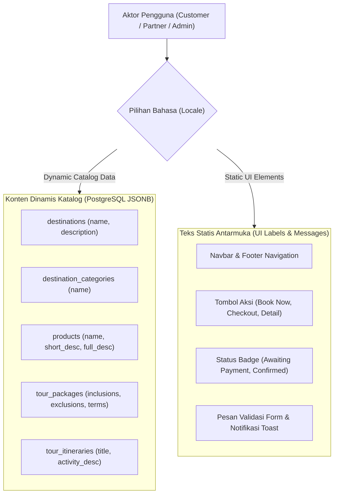

# Multilingual Architecture & Localization (i18n) Specification — BetaTudia (Muter-Muter App)

- **Document Version:** 1.0
- **Status:** Approved Post-Grooming
- **Scope:** Bilingual System (Bahasa Indonesia `id` & English `en`), PostgreSQL JSONB Schema, B-Tree & GIN Indexing, Google Cloud Translation Integration, Dynamic Partner/Admin Form UX & Customer UI Localization

---

## 1. Executive Summary & Vision

Platform **BetaTudia** melayani dua target audiens utama:
1. **Wisatawan Nusantara (Domestik):** Bahasa Indonesia (`id`) sebagai bahasa default aplikasi.
2. **Wisatawan Mancanegara (Internasional):** Bahasa Inggris (`en`) untuk menarik turis mancanegara ke destinasi kelas dunia seperti Bukit Lawang (Orangutan), Tangkahan (Gajah), Danau Toba, dan Dataran Tinggi Karo Berastagi.

Untuk mencapai skalabilitas tinggi tanpa mengorbankan performa database, sistem mengadopsi arsitektur **PostgreSQL JSONB Translatable Pattern** yang dipadukan dengan **Google Cloud Translation Service (Translate-on-Save)** serta antarmuka form dinamis ber-tab `ID` / `EN`.

---

## 2. Arsitektur Teks: Dinamis vs Statis

Sistem membedakan dua jenis teks secara tegas:



---

## 3. Skema Kolom Database & Pemetaan JSONB

Kolom-kolom teks dinamis katalog dimigrasikan dari `VARCHAR`/`TEXT` menjadi **`JSONB`**. Format data yang disimpan adalah objek key-value ISO-639-1:

```json
{
  "id": "Tur Sejarah Samosir & Tomok",
  "en": "Samosir & Tomok Heritage Cultural Tour"
}
```

### Tabel & Kolom Translatable:

| Tabel | Kolom | Tipe Data Baru | Contoh Nilai JSONB |
| :--- | :--- | :--- | :--- |
| `destination_categories` | `name` | `JSONB` | `{"id": "Air Terjun & Alam", "en": "Waterfalls & Nature"}` |
| `destinations` | `name` | `JSONB` | `{"id": "Bukit Holbung", "en": "Holbung Hill"}` |
| `destinations` | `description` | `JSONB` | `{"id": "Pemandangan bukit savana...", "en": "Savanna hills overlooking Lake Toba..."}` |
| `products` | `name` | `JSONB` | `{"id": "Paket Jelajah Danau Toba 3H2M", "en": "Lake Toba 3D2N Discovery Tour"}` |
| `products` | `short_description` | `JSONB` | `{"id": "Eksplorasi Tomok dan Ambarita...", "en": "Explore Tomok and Ambarita..."}` |
| `products` | `full_description` | `JSONB` | `{"id": "<p>Detail rencana perjalanan...</p>", "en": "<p>Full trip details...</p>"}` |
| `tour_packages` | `inclusions` | `JSONB` | `{"id": "Tiket kapal feri, pemandu lokal", "en": "Ferry ticket, local guide"}` |
| `tour_packages` | `exclusions` | `JSONB` | `{"id": "Pengeluaran pribadi, makan siang", "en": "Personal expenses, lunch"}` |
| `tour_packages` | `terms_conditions`| `JSONB` | `{"id": "Minimal 2 peserta...", "en": "Minimum 2 participants..."}` |
| `tour_itinerary_days` | `title` | `JSONB` | `{"id": "Hari 1: Tiba di Parapat", "en": "Day 1: Arrival in Parapat"}` |
| `tour_itinerary_days` | `description` | `JSONB` | `{"id": "Penjemputan di bandara...", "en": "Airport pick up and transfer..."}` |
| `tour_itinerary_stops` | `title` | `JSONB` | `{"id": "Desa Wisata Tomok", "en": "Tomok Heritage Village"}` |
| `tour_itinerary_stops` | `activity_description`| `JSONB` | `{"id": "Melihat tarian Sigale-gale", "en": "Witnessing Sigale-gale dance"}` |

> [!IMPORTANT]
> **Data yang TETAP Menggunakan Tipe Primitif:**
> - `slug` tetap berupa string ASCII unik (misal: `samosir-heritage-day-tour-abc123`) untuk menjaga kestabilan URL SEO dan tautan booking.
> - Data kuantitatif (harga `NUMERIC`, kuota, durasi hari/malam, tahun produksi mobil, plat nomor) tetap numerik/string standar.

---

## 4. Strategi Indexing PostgreSQL (Menjamin Kecepatan Milidetik)

Untuk mencegah penurunan performa (*sequential scan*) pada kolom JSONB, diterapkan 2 jenis indeks database:

### A. Expression B-Tree Index (Sorting & Filtering Cepat)
Digunakan saat melakukan `ORDER BY` nama produk/destinasi atau filter pencarian eksak berdasarkan locale aktif:
```sql
-- Indexing nama produk per bahasa
CREATE INDEX idx_products_name_id ON products ((name->>'id'));
CREATE INDEX idx_products_name_en ON products ((name->>'en'));

-- Indexing nama destinasi per bahasa
CREATE INDEX idx_destinations_name_id ON destinations ((name->>'id'));
CREATE INDEX idx_destinations_name_en ON destinations ((name->>'en'));
```

### B. GIN Full-Text Search Index (Pencarian Kata Kunci Multibahasa)
Digunakan oleh Search Bar marketplace di halaman utama dan katalog:
```sql
-- Full-Text Search Bahasa Indonesia
CREATE INDEX idx_products_fts_id ON products USING gin(
    to_tsvector('indonesian', coalesce(name->>'id', '') || ' ' || coalesce(short_description->>'id', ''))
);

-- Full-Text Search Bahasa Inggris
CREATE INDEX idx_products_fts_en ON products USING gin(
    to_tsvector('english', coalesce(name->>'en', '') || ' ' || coalesce(short_description->>'en', ''))
);
```

---

## 5. Eloquent Model Integration (`HasTranslations` Trait)

Model Eloquent menggunakan Trait `HasTranslations` sehingga kode controller publik tetap bersih dan intuitif:

```php
// Penggunaan di Controller Publik atau Resource:
$product = Product::find($id);

// Otomatis mengembalikan string bahasa yang sedang aktif (app()->getLocale()):
echo $product->name; 
// Jika locale = 'id' => "Paket Jelajah Danau Toba"
// Jika locale = 'en' => "Lake Toba Discovery Tour"

// Akses spesifik atau semua bahasa (untuk kebutuhan form edit partner/admin):
$allTranslations = $product->getTranslations('name'); // ['id' => '...', 'en' => '...']
$product->setTranslation('name', 'en', 'Updated English Title');
```

---

## 6. Integrasi Google Cloud Translation API (Translate-on-Save)

### Alur Kerja:
1. Vendor/Admin menginput form dalam bahasa default (**Bahasa Indonesia**).
2. Sistem menyediakan tombol **`✨ Terjemahkan Otomatis (Google Translate)`** pada form.
3. Saat tombol diklik (atau saat form disimpan jika field bahasa Inggris dibiarkan kosong):
   - `GoogleTranslationService` mengirimkan teks sumber (`id`) ke Google Cloud Translation API.
   - API merespons dengan hasil terjemahan bahasa Inggris (`en`).
   - Teks bahasa Inggris otomatis mengisi field `en`.
4. **Manual Override:** Vendor atau Admin dapat meninjau dan merevisi teks terjemahan secara manual (terutama untuk nama tempat lokal khas Batak/Karo seperti *Sigale-gale*, *Ulos*, *Batu Parsidangan*, *Aek Sipitudai*).

### Arsitektur Service:
- **`App\Services\GoogleTranslationService`**:
  - `translate(string $text, string $targetLocale = 'en', string $sourceLocale = 'id'): string`
  - `translateBatch(array $texts, string $targetLocale = 'en', string $sourceLocale = 'id'): array`
  - Mendukung **Mock Mode** (`TRANSLATION_MOCK_MODE=true` di `.env`) untuk pengujian lokal/CI testing tanpa kuota API eksternal.

---

## 7. Desain Antarmuka Form Dinamis (UX Partner & Admin)

Form input produk, destinasi, dan itinerary dirancang dinamis dengan mekanisme tab bahasa:

```
┌────────────────────────────────────────────────────────────────────────┐
│ Tambah / Edit Paket Wisata                                             │
├────────────────────────────────────────────────────────────────────────┤
│ Bahasa Konten:  [🇮🇩 Bahasa Indonesia (Utama)]  [🇬🇧 English]             │
│                                           [✨ Auto-Translate to EN]    │
├────────────────────────────────────────────────────────────────────────┤
│ Judul Paket Wisata (ID)*                                               │
│ [ Tur Sejarah Danau Toba & Samosir Heritage                        ]   │
│                                                                        │
│ Deskripsi Singkat (ID)*                                                │
│ [ Nikmati petualangan budaya Batak dan keindahan kaldera...        ]   │
│                                                                        │
│ Fasilitas / Inclusions (ID)                                            │
│ [ Tiket kapal feri PP, Pemandu berlisensi, Makan siang lokal       ]   │
└────────────────────────────────────────────────────────────────────────┘
```

- **Default State:** Tab `🇮🇩 Bahasa Indonesia` aktif secara default.
- **Dynamic Toggle:** Mengklik tombol `🇬🇧 English` langsung beralih menampilkan field bahasa Inggris tanpa me-reload halaman.
- **Smart Indicator:** Badge warna hijau kecil muncul pada tab `🇬🇧 English` jika teks bahasa Inggris sudah terisi.
- **Modal Component:** Berlaku konsisten untuk form halaman penuh maupun modal dinamis (seperti modal tambah hari itinerary dan titik perhentian tur).

---

## 8. Customer UI & Language Switcher di Navbar

1. **Komponen Switcher di Navbar (`resources/js/Components/LanguageSwitcher.vue`):**
   - Menampilkan pill dropdown atau button toggle di samping tombol profil:
     `🇮🇩 ID` | `🇬🇧 EN`
2. **Penyimpanan State:**
   - Locale pengguna disimpan di Cookie/Session (`locale`).
   - Route switcher: `POST /locale` dengan payload `{ locale: 'en' }`.
3. **Middleware Laravel (`SetLocaleMiddleware`):**
   - Mengatur `App::setLocale($locale)` pada setiap request.
   - Mengoper seluruh kamus frasa statis ke Inertia shared props:
     ```php
     'locale' => app()->getLocale(),
     'translations' => trans('ui'), // memuat file lang/{locale}/ui.php atau lang/{locale}.json
     ```
4. **Vue Composable Helper (`useTrans`):**
   - Di Vue template: `{{ t('book_now') }}` atau `{{ t('destinations') }}`.

---

## 9. Rencana Implementasi Bertahap (Roadmap)

- [ ] **Langkah 1: Setup Kamus UI & Locale Switcher**
  - Buat `lang/id.json` dan `lang/en.json` untuk teks navigasi, tombol, dan pesan status.
  - Buat endpoint `POST /locale` dan `SetLocaleMiddleware`.
  - Pasang komponen `LanguageSwitcher.vue` di `AppLayout.vue`.
- [ ] **Langkah 2: Migrasi Database JSONB & Indexing**
  - Buat migration PostgreSQL untuk mengonversi kolom translatable ke `JSONB`.
  - Tambahkan B-Tree Expression Index dan GIN Full-Text Index.
- [ ] **Langkah 3: Model Trait `HasTranslations`**
  - Implementasikan trait `HasTranslations` pada model `Product`, `Destination`, `DestinationCategory`, `TourPackage`, `TourItineraryDay`, `TourItineraryStop`.
- [ ] **Langkah 4: Google Cloud Translation Service**
  - Buat `GoogleTranslationService` lengkap dengan mock mode untuk pengujian unit/feature.
- [ ] **Langkah 5: Pembaruan Form Input Partner & Admin**
  - Update `CreateTour.vue`, `CreateVehicle.vue`, dan modal itinerary dengan tab dinamis `ID / EN` dan tombol *Auto-Translate*.
- [ ] **Langkah 6: Automated Testing**
  - Tulis feature tests untuk locale switching, query pencarian multilingual, trait `HasTranslations`, dan fallback translasi.

