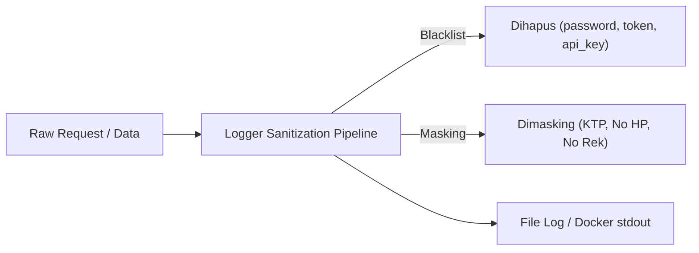

# Logging, Tracing & Audit Trail Specification — Muter-Muter Danau Toba

- **Document Version:** 1.0
- **Status:** Approved Architecture Specification
- **Target Stack:** Laravel 11 + Monolog + Docker (FrankenPHP) + PostgreSQL 15

---

## 1. Filosofi & Pendekatan Arsitektur

Sistem logging Muter-Muter Danau Toba mengadopsi prinsip **Unified Stream with Correlation Tracing**:

1. **Satu Aliran Log Terpadu (Single Unified Log Stream):**
   - Seluruh log aplikasi (HTTP, Autentikasi, Booking, Pembayaran, Notifikasi, Error) dikumpulkan ke **SATU aliran file rotasi** (`storage/logs/laravel-YYYY-MM-DD.log`) dan `stdout` Docker container.
   - **TIDAK dipecah** menjadi file fisik terpisah (`auth.log`, `booking.log`, dll.) agar kronologi kejadian tidak terfragmentasi dan investigasi insiden dapat dilakukan secara linier.
2. **Korelasi Menggunakan `trace_id`:**
   - Setiap interaksi pengguna menghasilkan satu `trace_id` unik (UUID / NanoID) yang mengikat seluruh aktivitas mulai dari HTTP Request masuk, query database, dispatch event, hingga log selesai.
3. **Pemisahan Log Operasional vs Audit Trail:**
   - **Log File / Docker (Ephemeral):** Untuk debugging teknis, performa, monitoring error, dan riwayat request dengan masa simpan terbatas (retensi 14 hari).
   - **Audit Logs Database (Persistent):** Disimpan permanen di tabel PostgreSQL (`audit_logs` & `booking_status_histories`) untuk kebutuhan akuntabilitas hukum, sengketa finansial, dan tampilan riwayat di antarmuka (UI) Super Admin.

---

## 2. Struktur Schema Standar (Canonical JSON Envelope)

Setiap entri log wajib diformat dalam struktur JSON standar yang konsisten di seluruh channel:

```json
{
  "timestamp": "2026-11-07T04:15:30.123Z",
  "level": "INFO",
  "service": "muter-muter-app",
  "channel": "booking",
  "event": "booking.status_changed",
  "message": "Status booking BK-202611-0001 berubah dari PENDING_APPROVAL menjadi AWAITING_PAYMENT",
  "trace_id": "req-9b1deb4d-3b7d-4bad-9bdd-2b0d7b3dcb6d",
  "actor": {
    "user_id": "9b1deb4d-3b7d-4bad-9bdd-2b0d7b3dcb6d",
    "role": "PARTNER_OWNER",
    "ip": "180.244.120.10",
    "user_agent": "Mozilla/5.0 (Windows NT 10.0; Win64; x64)..."
  },
  "context": {
    "booking_id": "3c9b7b9f-6e82-4f0e-b81b-586b88b7764f",
    "booking_code": "BK-202611-0001",
    "partner_id": "8a7b6c5d-4e3f-2a1b-0c9d-8e7f6a5b4c3d",
    "previous_status": "PENDING_APPROVAL",
    "new_status": "AWAITING_PAYMENT",
    "hold_expires_at": "2026-11-08T04:15:30Z"
  }
}
```

### Penjelasan Elemen Root Envelope:
| Field | Tipe | Deskripsi |
| :--- | :--- | :--- |
| `timestamp` | `string` | Format ISO 8601 UTC dengan milidetik (`YYYY-MM-DDTHH:mm:ss.sssZ`). |
| `level` | `string` | Standar RFC 5424: `EMERGENCY`, `ALERT`, `CRITICAL`, `ERROR`, `WARNING`, `NOTICE`, `INFO`, `DEBUG`. |
| `service` | `string` | Identitas micro-app/monolith: `"muter-muter-app"`. |
| `channel` | `string` | Klasifikasi domain log: `application`, `auth`, `booking`, `payment`, `notification`, `settlement`. |
| `event` | `string` | Kode spesifik peristiwa berformat dot-notation: `<channel>.<entity>.<action>`. |
| `message` | `string` | Ringkasan kejadian yang mudah dibaca manusia (*human-readable*). |
| `trace_id` | `string` | ID penelusuran per request HTTP / background job (`req-<uuid>`). |
| `actor` | `object` | Identitas pengguna penanggung jawab aksi (`user_id`, `role`, `ip`). Jika dipicu cron otomatis: `"role": "SYSTEM_CRON"`. |
| `context` | `object` | Kumpulan data spesifik domain yang relevan (ID entitas, perubahan nilai, payload respon). |

---

## 3. Klasifikasi Saluran (Channels) & Event Standar

### A. Channel: `application` (Teknis & Performa)
- `application.request.completed`: Pencatatan HTTP response time (`status_code`, `duration_ms`, `endpoint`).
- `application.database.slow_query`: Query PostgreSQL yang memakan waktu > 500ms.
- `application.exception.unhandled`: Error runtime 500 yang tidak tertangani.

### B. Channel: `auth` (Keamanan & Sesi Pengguna)
- `auth.login.success`: Pengguna berhasil login (mencatat `user_id`, `role`, `ip`).
- `auth.login.failed`: Percobaan login gagal (mencatat `email`, alasan kegagalan, deteksi brute-force).
- `auth.logout`: Pengguna mengakhiri sesi.
- `auth.password.reset_requested`: Pengajuan tautan reset password.

### C. Channel: `booking` (Siklus Pesanan & SLA)
- `booking.created`: Pesanan baru dibuat customer (`PENDING_APPROVAL`, kalkulasi snapshot harga).
- `booking.vendor.approved`: Mitra menyetujui ketersediaan (membuat hold inventaris 24 jam).
- `booking.vendor.rejected`: Mitra menolak pesanan karena armada/slot penuh.
- `booking.sla.breached`: Scheduler mendeteksi 24 jam tanpa respon mitra (eskalasi ke `MANUAL_REVIEW`).
- `booking.admin.intervened`: Super Admin melakukan *force approve* atau pembatalan manual.
- `booking.cancelled`: Pembatalan oleh customer dengan kalkulasi persentase refund.

### D. Channel: `payment` (Keuangan & Bukti Transfer)
- `payment.proof.uploaded`: Customer mengunggah struk transfer DP (format file, ukuran file, nominal).
- `payment.proof.verified`: Admin menyetujui pembayaran (booking menjadi `CONFIRMED`, inventaris `ALLOCATED`).
- `payment.proof.rejected`: Admin menolak struk transfer (alasan penolakan).
- `payment.hold.expired`: Pembayaran DP tidak diselesaikan dalam 24 jam (inventaris `RELEASED`).

### E. Channel: `notification` (Gerbang Pesan WhatsApp)
- `notification.whatsapp.dispatched`: Pesan WhatsApp berhasil dikirim via Go WA Gateway.
- `notification.whatsapp.failed`: Pengiriman pesan WhatsApp gagal / gateway timeout.

### F. Channel: `settlement` (Bagi Hasil Vendor)
- `settlement.eligible`: Perjalanan selesai (`COMPLETED`), hak bayar mitra (90%) siap dicairkan.
- `settlement.payout_executed`: Super Admin mengeksekusi transfer dana bagi hasil ke rekening mitra.

---

## 4. Strategi Rotasi Log (Log Rotation & VPS Disk Protection)

Untuk mencegah disk server VPS penuh akibat akumulasi file log, diterapkan rotasi di dua layer independen:

### Layer 1: Rotasi Internal Laravel (Daily Rotation)
- **Driver:** `daily` (Monolog `RotatingFileHandler`).
- **Pola Penamaan:** `storage/logs/laravel-YYYY-MM-DD.log`.
- **Masa Retensi (`LOG_DAILY_DAYS`):** **14 Hari**.
- Log yang berusia lebih dari 14 hari akan dihapus otomatis oleh sistem tanpa intervensi manual.
- **Konfigurasi Lingkungan (`.env`):**
  ```ini
  LOG_CHANNEL=daily
  LOG_LEVEL=info
  LOG_DAILY_DAYS=14
  ```

### Layer 2: Rotasi Docker Container Daemon (VPS Layer)
- Container Docker `muter-muter-app` menulis log output ke driver `json-file`.
- Dikonfigurasi dengan pembatasan ukuran maksimal per file dan jumlah file rotasi:
  ```yaml
  logging:
    driver: "json-file"
    options:
      max-size: "20m"
      max-file: "5"
  ```
  *(Total kapasitas disk maksimal yang digunakan log Docker dibatasi strictly di bawah 100 MB).*

---

## 5. Aturan Proteksi Data Sensitif (PII & Data Masking)

Sistem melarang keras pencatatan data rahasia ke dalam file log teks.



### Daftar Aturan Sanitasi:
1. **Daftar Hitam Mutlak (Dihapus Total):**
   - `password`, `password_confirmation`, `current_password`
   - `token`, `remember_token`, `whatsapp_token`, `api_token`
   - Kredensial database atau environment secret.
2. **Aturan Masking (Sensor Parsial):**
   - **Nomor KTP:** Disensor bagian tengah, contoh `127101********0001`.
   - **Nomor Rekening Bank:** Disensor bagian tengah, contoh `107-***-***-1`.
   - **Nomor WhatsApp / HP:** Disensor digit tengah, contoh `0812****7890`.

---

## 6. Integrasi Audit Trail Database (`audit_logs`)

Perubahan data master dan intervensi operasional yang memiliki konsekuensi finansial atau administratif wajib dicatat ganda ke tabel PostgreSQL `audit_logs`:

### Skema Tabel `audit_logs`:
| Kolom | Tipe Data | Deskripsi |
| :--- | :--- | :--- |
| `id` | `UUID (PK)` | Primary Key UUID v4. |
| `user_id` | `UUID (FK, Nullable)` | Aktor yang melakukan aksi (Admin / Mitra / Customer / NULL jika sistem). |
| `auditable_type` | `VARCHAR(255)` | Model Eloquent yang dimodifikasi (misal: `App\Models\Product`, `Partner`). |
| `auditable_id` | `UUID` | ID entitas yang dimodifikasi. |
| `event` | `VARCHAR(50)` | Jenis aksi: `CREATED`, `UPDATED`, `DELETED`, `STATUS_CHANGE`. |
| `old_values` | `JSONB` | Nilai data sebelum perubahan. |
| `new_values` | `JSONB` | Nilai data setelah perubahan. |
| `ip_address` | `VARCHAR(45)` | Alamat IP aktor. |
| `user_agent` | `TEXT` | Peramban / agen pengguna. |
| `created_at` | `TIMESTAMPTZ` | Waktu pencatatan. |

---

## 7. Panduan Cepat Investigasi & Tracing (Cheatsheet)

Dengan skema satu file terpadu ini, administrator / developer di server VPS dapat melakukan penelusuran secara instan:

### 1. Menelusuri seluruh alur dari satu request pengguna:
```bash
grep "req-9b1deb4d-3b7d-4bad-9bdd-2b0d7b3dcb6d" storage/logs/laravel-$(date +%Y-%m-%d).log
```

### 2. Menelusuri seluruh riwayat satu kode booking spesifik:
```bash
grep "BK-202611-0001" storage/logs/laravel-*.log
```

### 3. Memantau transaksi pembayaran gagal secara real-time:
```bash
tail -f storage/logs/laravel-$(date +%Y-%m-%d).log | grep '"channel":"payment"' | grep '"level":"ERROR"'
```

### 4. Memeriksa aktivitas login yang gagal (indikasi brute-force):
```bash
grep "auth.login.failed" storage/logs/laravel-*.log | jq '{timestamp: .timestamp, ip: .actor.ip, email: .context.email}'
```

### 5. Memeriksa log langsung via container Docker:
```bash
docker logs --tail 200 -f muter-muter-app | grep "booking.sla.breached"
```

