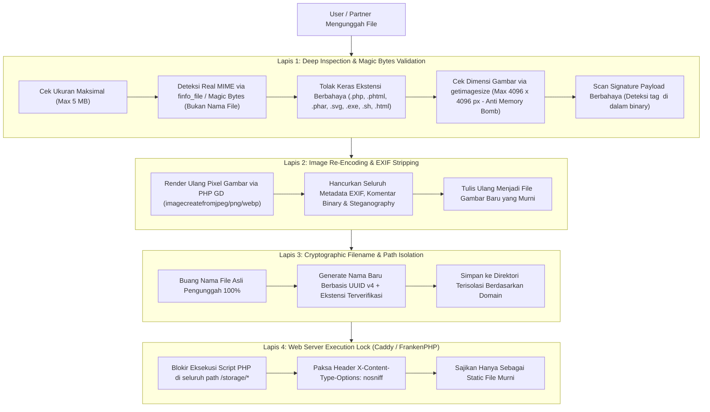

# Security Hardening & File Upload Architecture — BetaTudia (Muter-Muter App)

- **Document Version:** 1.0
- **Status:** Approved Post-Grooming
- **Scope:** SQL Injection Prevention, Application Security, 4-Layer File Upload Defense, Storage Persistence & Web Server Hardening

---

## 1. Executive Summary

Platform **BetaTudia** mengelola data sensitif termasuk dokumen legal mitra (KTP, NIB), bukti transfer bank pelanggan, foto armada/paket wisata, serta transaksi finansial. Dokumen ini menetapkan standar keamanan berlapis (*Defense in Depth*) untuk menjamin aplikasi bebas dari celah **SQL Injection**, **Remote Code Execution (RCE / Web Shell)** via upload file, **Stored XSS**, dan **Decompression Bomb (DoS)**.

---

## 2. Database & SQL Injection Defense

1. **Zero Raw Unparameterized SQL:**
   - Seluruh interaksi database **WAJIB** menggunakan Eloquent ORM atau Query Builder dengan *PDO Prepared Statements*.
   - Penggunaan konkatenasi variabel langsung di dalam SQL string (`DB::raw("... $input")`, `whereRaw("... $input")`) **DILARANG KERAS**.
2. **Strict Type Enforcement (PostgreSQL 15+):**
   - Seluruh Primary Key dan Foreign Key menggunakan tipe native `UUID` (v4). Input non-UUID otomatis ditolak sebelum menyentuh eksekusi query.
   - Seluruh nilai finansial menggunakan `NUMERIC(14,2)`.
3. **Mass Assignment Protection:**
   - Setiap model Eloquent secara eksplisit mendefinisikan `$fillable` dan memvalidasi payload melalui `$request->validate([...])`.

---

## 3. Storage Persistence Architecture (Docker & VPS)

Seluruh file yang diunggah disimpan di luar container layer yang bersifat *ephemeral*, melainkan dipetakan langsung ke *host volume* VPS agar **aman dan tidak hilang saat rebuild/redeploy**:

| Jenis Aset | Lokasi di Container | Mount Volume di Host VPS | URL Akses |
| :--- | :--- | :--- | :--- |
| **Brand Static Assets** (Logo, Icon) | `/app/public/images` | Baked in image & Git repo | `/images/...` |
| **Public Uploaded Media** (Foto Tour, Mobil, Bukti) | `/app/storage/app/public` | `./storage/public` | `/storage/...` (via symlink) |
| **Application & Audit Logs** | `/app/storage/logs` | `./storage/logs` | Internal / Docker stderr |

---

## 4. 4-Layer File Upload Defense (Anti-Malware & Anti-Webshell)

Untuk mencegah penyusupan kode jahat (*PHP Web Shell*, *Polyglot Image*, *SVG XSS*, atau *Null-Byte Injection*), setiap titik upload wajib melewati **4 Lapis Pertahanan**:

### Detail Lapis 1: Validasi Mendalam (`FileSecurityService`)
- **Larangan Mutlak SVG pada User Upload:** File `.svg` berbasis XML dan dapat menyembunyikan `<script>` (Stored XSS). User/Vendor **hanya** diizinkan mengunggah format raster murni (`image/jpeg`, `image/png`, `image/webp`) dan dokumen `application/pdf` (khusus KTP/NIB/Bukti Transfer).
- **Inspeksi Magic Bytes (`finfo`):** Sistem memeriksa *magic bytes* header file fisik (`\xFF\xD8\xFF` untuk JPEG, `\x89PNG` untuk PNG, `%PDF-` untuk PDF), bukan mempercayai ekstensi dari nama file pengguna.
- **Deteksi Malware Signature di Dalam File:** Membaca isi stream file untuk memastikan tidak ada injeksi tag `<?php`, `<?=`, `<script`, atau `eval(` yang disisipkan di dalam gambar/PDF (*Polyglot Attack*).
- **Proteksi Decompression Bomb:** Membatasi resolusi dimensi maksimal gambar pada `4096 x 4096` piksel agar server tidak kehabisan memori (RAM) saat memproses gambar.

### Detail Lapis 2: Re-Encoding Gambar & Penghapusan EXIF
- Setiap gambar (`jpg`, `png`, `webp`) yang lolos validasi dibuka menggunakan pustaka grafis **PHP GD** dan di-*encode* ulang menjadi file baru.
- Proses ini **menghancurkan 100% metadata EXIF** (termasuk koordinat GPS tersembunyi dan komentar binary tempat peretas biasa menyembunyikan kode PHP).

### Detail Lapis 3: Sanitasi Nama File (UUID Naming)
- Nama file asli dari pengguna (misal `bukti_transfer_shell.php.jpg`) **tidak pernah disimpan**.
- Sistem men-generate nama baru dengan format: `{UUID-v4}.{verified_ext}` (contoh: `a8f9d210-4c3b-4e1a-9b2c-123456789abc.jpg`).

### Detail Lapis 4: Hardening Web Server (`docker/Caddyfile`)
- Pada konfigurasi FrankenPHP / Caddy, setiap request yang menuju `/storage/*`:
  - **Dilarang keras** diteruskan ke `php_server` (interpreter PHP).
  - Setiap request ke `/storage/*.php` atau `/storage/*.phar` langsung diblokir dengan status HTTP `403 Forbidden`.
  - Dilengkapi response header `X-Content-Type-Options: nosniff` dan `Content-Security-Policy: default-src 'none'; style-src 'unsafe-inline'; sandbox` agar browser tidak pernah mengeksekusi file statis sebagai HTML/JavaScript aktif.

---

## 5. Daftar Titik Upload yang Dilindungi

| Modul | Field Input | Format Diizinkan | Ukuran Maks | Re-Encode GD | Path Penyimpanan |
| :--- | :--- | :--- | :--- | :--- | :--- |
| **Bukti Pembayaran** (`PaymentProofController`) | `proof_file` | `jpg, jpeg, png, webp, pdf` | 5 MB | Ya (jika gambar) | `payments/proofs/` |
| **Registrasi Mitra - KTP** (`PartnerRegisterController`) | `ktp_file` | `jpg, jpeg, png, pdf` | 5 MB | Ya (jika gambar) | `partner_documents/ktp/` |
| **Registrasi Mitra - NIB** (`PartnerRegisterController`) | `nib_file` | `jpg, jpeg, png, pdf` | 5 MB | Ya (jika gambar) | `partner_documents/nib/` |
| **Registrasi Mitra - Foto Armada** (`PartnerRegisterController`) | `fleet_photos.*` | `jpg, jpeg, png, webp` | 5 MB | Ya (Wajib) | `partner_documents/fleet/` |
| **Katalog Paket Tour** (`PartnerProductController`) | `photos.*` | `jpg, jpeg, png, webp` | 5 MB | Ya (Wajib) | `products/tours/` |
| **Katalog Rental Kendaraan** (`PartnerProductController`) | `photos.*` | `jpg, jpeg, png, webp` | 5 MB | Ya (Wajib) | `products/vehicles/` |

