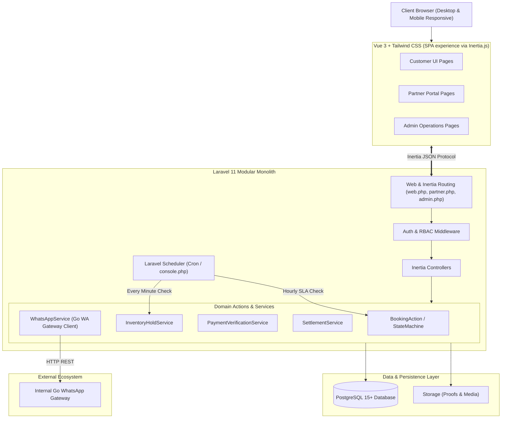

# System Architecture & Technical Design — Lake Toba Travel Marketplace

- **Document Version:** 1.0
- **Status:** Approved Post-Grooming
- **Architecture Style:** Modular Monolith (Laravel 11 + Inertia.js + Vue 3 + PostgreSQL)

---

## 1. Architectural Philosophy & Overview

The system is designed as a **Modular Monolith** in a single repository. It provides high developer productivity, straightforward transactional integrity, and zero distributed-system overhead for the MVP stage.

---

## 2. Key Architectural Decisions

| Decision | Choice | Rationale |
| :--- | :--- | :--- |
| **Monolith vs Microservices** | Modular Monolith | Microservices introduce unnecessary network latency, distributed transaction complexity (SAGA), and high operational cost. Monolith gives ACID transactions out of the box. |
| **Inertia.js vs Pure REST API** | Inertia.js + Vue 3 | Eliminates the need to maintain duplicate API schemas and client-side routing. Controllers return Inertia views with typed props directly. |
| **Primary Keys** | UUID v4 | Prevents enumeration attacks on booking codes, partner documents, and invoice IDs. Safe for future sharding. |
| **Financial Representation** | `NUMERIC(14,2)` | Avoids floating-point precision loss in currency calculations and commission percentages. |
| **Background Processing** | Synchronous + Scheduler | No Redis or RabbitMQ required for MVP. Scheduler periodically evaluates hold expiration and SLA breaches. |
| **External Communication** | Go WhatsApp API | Modular service wrapper isolates HTTP communication with fallback logging for local test environments. |

---

## 3. Domain Boundaries & Module Structure

The application is structured into clearly separated business domains:

1. **Identity & Access Control Domain (`app/Models/User`, `app/Policies`):**
   - RBAC using Spatie Laravel-Permission or native policies.
   - Distinct roles: `Customer`, `Partner Owner`, `Partner Staff`, `Admin`, `Super Admin`.
2. **Partner Domain (`app/Models/Partner`, `app/Models/PartnerMember`):**
   - Partner profile, KYC documents verification, multi-staff relationship, payout bank credentials.
3. **Destination & Catalog Domain (`app/Models/Destination`, `app/Models/Product`):**
   - Destinations, categories, media, tour packages, vehicles, departures.
   - Catalog lifecycle (`DRAFT`, `PENDING_REVIEW`, `APPROVED`, `PUBLISHED`).
4. **Inventory & Availability Domain (`app/Models/InventoryHold`, `app/Models/VehicleAvailability`):**
   - Seat quota tracking, vehicle booking date collision detection, 24h temporary hold release.
5. **Booking & Order Domain (`app/Models/Booking`, `app/Models/BookingStatusHistory`):**
   - Independent state management, product JSON snapshotting, lead-time validation.
6. **Payment & Finance Domain (`app/Models/Payment`, `app/Models/Refund`, `app/Models/VendorSettlement`):**
   - Manual bank transfer verification, DP tracking, 10% commission calculation, completed trip payout ledger.
7. **Communication Domain (`app/Services/WhatsAppService`):**
   - Dispatches transactional WhatsApp alerts (booking approved, hold reminder, payment confirmed).

---

## 4. Concurrency & Transactional Safety

To eliminate race conditions, double bookings, and inventory overselling:
- **Database Transactions:** Every state transition involving Booking, Inventory, or Payment must run inside `DB::transaction(function () { ... })`.
- **Row-Level Locking:** Use `lockForUpdate()` during inventory hold acquisition to prevent simultaneous checkouts from reserving the same vehicle or oversubscribing open trip quotas.
- **Idempotency:** Payment verification actions must check current status before mutating state to prevent duplicate confirmations or double payouts.

---

## 5. Security & Compliance Architecture

- **CSRF Protection:** Native Laravel CSRF tokens validated on all mutation requests.
- **File Upload Hardening:** Strict MIME-type checking (JPEG, PNG, WebP, PDF only) and random UUID-based file naming; files stored outside public root or in protected object storage.
- **Authorization Enforcement:** Every controller endpoint MUST execute `$this->authorize(...)` using dedicated Laravel Policies.
- **Data Privacy:** Customer phone numbers and bank account numbers are only accessible to authorized Admins and assigned fulfillment Partners.

