# Implementation Plan — Lake Toba Travel Marketplace

- **Document Version:** 1.0
- **Status:** All Phases 0–9 Completed & 100% Tested (84 Automated Tests Passing)
- **Target Architecture:** Laravel 11 + Vue 3 + Inertia.js + PostgreSQL

---

## 1. Roadmap Overview & Phasing Strategy

The development follows an incremental, test-driven approach. Each phase delivers a functional, testable slice of the platform.

```mermaid
flowchart LR
    P0["Phase 0: Grooming & Specs"] --> P1["Phase 1: Project Scaffolding"]
    P1 --> P2["Phase 2: Database Schema & Enums"]
    P2 --> P3["Phase 3: Auth, RBAC & Partners"]
    P3 --> P4["Phase 4: Destinations & Catalog"]
    P4 --> P5["Phase 5: Booking Engine & SLA"]
    P5 --> P6["Phase 6: Payment & Inventory Hold"]
    P6 --> P7["Phase 7: WhatsApp Integration"]
    P7 --> P8["Phase 8: Refunds & Settlements"]
    P8 --> P9["Phase 9: Quality & Launch Prep"]
```

---

## 2. Detailed Phase Specifications

### Phase 0: Grooming, Requirements & Architectural Sign-off (Current Status: Complete)
- Finalize PRD, Business Rules, User Stories, and User Flows.
- Establish ERD, Data Dictionary, and Technical Architecture.
- Review and lock all high-impact business decisions with stakeholders.

### Phase 1: Environment Setup & Project Scaffolding
- Initialize clean Laravel 11 application in workspace.
- Configure Inertia.js with Vue 3 (Composition API) and Vite.
- Install and configure Tailwind CSS 3.x with mobile-responsive design system.
- Setup PostgreSQL connection with UUID extension (`pgcrypto`).
- Setup baseline layouts: `AppLayout` (Customer), `PartnerLayout` (Mitra), `AdminLayout` (Operations).

### Phase 2: Database Schema, Enums, and Seeders
- Create database migrations using UUID primary keys for all domain tables.
- Define PHP 8.2+ backed Enums:
  - `BookingStatus`, `PaymentStatus`, `InventoryStatus`
  - `ProductType`, `OwnershipType`, `ApprovalStatus`
  - `TourType`, `VehicleType`, `PartnerRole`
- Implement seeders for:
  - Roles and Permissions (`Customer`, `Partner Owner`, `Partner Staff`, `Admin`).
  - Core Lake Toba clusters (Parapat, Samosir East, Samosir West, Merek/Tongging).
  - Initial platform test admin account and mock partner profiles.

### Phase 3: Authentication, RBAC, and Partner Onboarding
- Configure Laravel Breeze / Fortify with Inertia Vue authentication views.
- Implement Partner registration flow with KYC document upload (KTP, NIB, Fleet photos).
- Implement Admin verification interface for partner approval/rejection.
- Implement Partner multi-staff invitation and assignment (`Partner Owner` vs `Partner Staff`).
- Write Laravel Policies for strict multi-tenant partner isolation.

### Phase 4: Product Catalog & Destination Discovery
- Implement Destination listing and detail pages with category and cluster filtering.
- Implement Partner Product submission workflow for Tour Packages and Vehicle Rentals.
- Implement Admin product review and publishing pipeline.
- Implement public Tour Package detail view (daily itinerary, inclusions, ferry inclusions, pricing).
- Implement public Vehicle Rental detail view (specs, transmission, capacity, driver option).

### Phase 5: Booking Engine, Lead-Time Check & SLA Timers
- Implement Checkout wizard on web with login/registration gate.
- Enforce minimum booking lead time validation:
  - H-1 (24 hours) for Tour Packages.
  - H-12 hours for Vehicle Rentals.
- Generate unique public booking code (e.g. `BK-202611-0001`).
- Write JSONB product and pricing snapshots to booking record.
- Implement 24-hour vendor response SLA timer.
- Setup Laravel Scheduler task to detect SLA breaches and elevate to `MANUAL_REVIEW`.

### Phase 6: Inventory Hold & Semi-Automated Payment Verification
- Implement Vendor approval action triggering 24-hour temporary inventory hold (`inventory_holds`).
- Generate Down Payment (DP) bill (default 30%, admin adjustable).
- Build Customer Payment screen displaying platform bank accounts (BCA, Mandiri) and DP breakdown.
- Implement payment proof upload (file storage + preview).
- Build Admin Payment Review dashboard with mutation matching and 1-click verification.
- Implement state transitions: Booking `CONFIRMED`, Payment `PARTIALLY_PAID`, Inventory `ALLOCATED`.

### Phase 7: WhatsApp Notification Integration
- Create modular `WhatsAppService` adhering to `WhatsAppNotificationInterface`.
- Implement HTTP client integration with the internal Go WhatsApp API Gateway.
- Implement configurable `.env` settings (`WHATSAPP_GATEWAY_URL`, `WHATSAPP_API_TOKEN`).
- Implement automated event notifications:
  - New booking request alert to Partner PIC (SLA 24h countdown).
  - Booking approved & DP payment instructions with bank details to Customer.
  - Payment verified & booking confirmed voucher to Customer.
  - 24-hour hold expiration notice if unpaid.

### Phase 8: Cancellation, Refund Engine & Vendor Settlement
- Implement Customer cancellation request interface with automatic percentage calculation based on departure timestamp (>7d: 100%, 3-7d: 50%, <3d: 0%).
- Ensure refunds are strictly computed on amounts actually paid.
- Build Admin Refund processing queue and payout recording.
- Implement trip fulfillment completion trigger (`COMPLETED`).
- Build Vendor Settlement ledger: calculate net entitlement (`Gross - 10% Platform Commission`).
- Build Admin payout reconciliation interface.

### Phase 9: Comprehensive Testing & Launch Preparation
- Write Pest / PHPUnit Feature tests covering:
  - Booking state machine transitions and invalid transition prevention.
  - 24-hour inventory hold expiration via scheduler.
  - Minimum lead-time boundary checks.
  - Concurrency locks on simultaneous vehicle bookings.
- Conduct cross-browser and mobile viewport usability testing.
- Review SEO metadata and OpenGraph tags for Lake Toba attractions.

