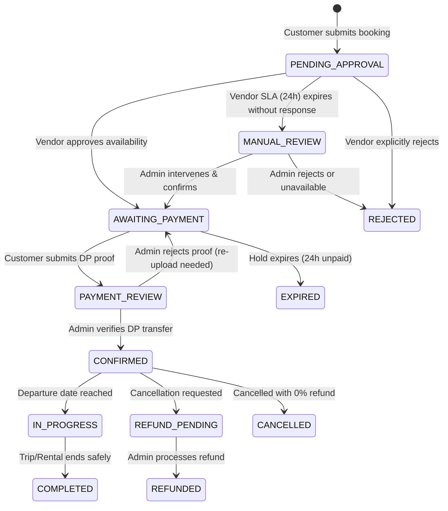

# Business Rules & Policy Engine — Lake Toba Travel Marketplace

- **Document Version:** 1.0
- **Status:** Final & Approved
- **Scope:** Canonical reference for all transactional, validation, and domain logic.

---

## 1. Product Catalog & Ownership Rules

### 1.1 Ownership Types
- `INTERNAL`: Managed, operated, and fulfilled directly by the platform team.
  - Rule: `partner_id` MUST be null.
  - Automatically approved upon creation by Admin.
- `PARTNER`: Provided by an approved external local operator or vendor.
  - Rule: `partner_id` MUST reference an active, approved `partners` record.
  - Must undergo Admin approval before becoming publicly active (`approval_status = APPROVED` and `status = PUBLISHED`).

### 1.2 Status Separation
A product maintains two independent status flags:
- `approval_status`: `DRAFT`, `PENDING_REVIEW`, `APPROVED`, `REJECTED`
- `status`: `DRAFT`, `PUBLISHED`, `ARCHIVED`, `SUSPENDED`
- **Rule:** A partner can only toggle `status = PUBLISHED` if `approval_status == APPROVED`.

### 1.3 Immutability of Historical Bookings
- Modifying a product's price, description, terms, or cancellation policy MUST NOT affect past or active bookings.
- When a booking is initialized, a comprehensive JSONB snapshot of the product and its policies is written to the booking record.

---

## 2. Booking Lifecycle & State Machine Rules

### 2.1 Independent State Dimensions
The platform strictly separates the lifecycle into three orthogonal dimensions:
1. **Booking Status:** Overall contractual agreement state.
2. **Payment Status:** Financial collection and balance state.
3. **Inventory Status:** Physical capacity and unit allocation state.

### 2.2 Booking Status Definitions
- `PENDING_APPROVAL`: Initial state upon checkout submission.
- `MANUAL_REVIEW`: Vendor did not respond within 24h; flagged for Admin manual intervention.
- `AWAITING_PAYMENT`: Vendor confirmed availability; 24h temporary hold active; awaiting DP payment.
- `PAYMENT_REVIEW`: Customer has uploaded payment proof; awaiting Admin verification.
- `CONFIRMED`: Minimum DP verified; inventory allocated; booking contractually locked.
- `IN_PROGRESS`: Service is actively taking place.
- `COMPLETED`: Service successfully fulfilled. Triggers partner settlement eligibility.
- `REJECTED`: Request rejected by vendor or admin due to unavailability.
- `EXPIRED`: Customer failed to submit payment proof within the 24-hour hold window.
- `CANCELLED`: Booking cancelled by customer or vendor (without pending financial refund).
- `REFUND_PENDING`: Cancellation approved; refund payout is awaiting admin processing.
- `REFUNDED`: Refund payout completed.

### 2.3 Payment Status Definitions
- `UNPAID`: Zero funds verified.
- `PAYMENT_REVIEW`: Payment proof uploaded by customer, awaiting verification.
- `PARTIALLY_PAID`: Minimum DP verified, remaining balance outstanding.
- `PAID`: 100% of the total booking price has been received and verified.
- `OVERDUE`: Remaining balance unpaid past the designated threshold (requires admin review).
- `REFUND_PENDING`: Awaiting refund disbursement.
- `REFUNDED`: Full or partial refund disbursed.

### 2.4 Inventory Status Definitions
- `NONE`: No capacity or unit is held.
- `HELD`: Temporary hold active (bounded by 24h timer).
- `ALLOCATED`: Contractually guaranteed inventory (post-DP confirmation).
- `RELEASED`: Previously held or allocated inventory returned to public availability.

---

## 3. SLA, Lead Time, and Availability Rules

### 3.1 Vendor Response SLA
- Every booking in `PENDING_APPROVAL` starts a **24-hour vendor response timer**.
- **Rule:** If the vendor does NOT respond within 24 hours, the system MUST transition the booking status to `MANUAL_REVIEW`.
- Automatic hard expiration is forbidden; Admin is notified to contact the vendor or reassign to an alternative unit.

### 3.2 Minimum Booking Lead Time
- **Tour Packages:** Pemesanan wajib dilakukan minimal **H-1 (24 jam)** sebelum waktu keberangkatan.
- **Vehicle Rentals:** Pemesanan wajib dilakukan minimal **H-12 jam** sebelum waktu sewa dimulai.
- Booking requests submitted within the restricted lead time are blocked by validation.

### 3.3 Temporary Inventory Hold (24-Hour Rule)
- Upon vendor approval, the booking enters `AWAITING_PAYMENT` and an `inventory_holds` record is created with `expires_at = NOW() + 24 HOURS`.
- During this 24-hour window, the requested seats (for tours) or the requested vehicle unit are held from other customers.
- If the customer fails to upload valid payment proof within 24 hours:
  - Inventory status transitions to `RELEASED`.
  - Booking status transitions to `EXPIRED`.
  - Notification sent to customer via WhatsApp.

---

## 4. Payment & Down Payment (DP) Rules

### 4.1 Down Payment Configuration
- The system supports a configurable DP percentage.
- **Default System DP:** **30%** of the total product price.
- Admin has the authority to adjust DP percentages per product or catalog category.
- Customer may choose to pay either:
  1. Minimum Down Payment (e.g., 30%).
  2. Full Payment (100%).

### 4.2 Balance Settlement (Pelunasan)
- Outstanding balance may be paid incrementally or in full at any time up until the departure date/time.
- A booking remains `CONFIRMED` even if payment status is `PARTIALLY_PAID`.
- Late balance payments on departure day do not trigger automated cancellation; they are flagged for operational and driver/tour-leader confirmation.

### 4.3 Manual Bank Transfer Verification Flow
1. Booking reaches `AWAITING_PAYMENT`.
2. System displays platform bank accounts (BCA, Mandiri, BRI) and exact payment amount with an automated WhatsApp notification dispatched to the customer.
3. Customer transfers funds and uploads proof image (JPG, PNG, PDF up to 5MB) on the web portal.
4. Booking status updates to `PAYMENT_REVIEW`.
5. Admin verifies the transaction in the bank ledger:
   - If valid: Admin marks payment as `VERIFIED`. Booking moves to `CONFIRMED` (or `PARTIALLY_PAID` / `PAID`).
   - If invalid/fraudulent: Admin rejects proof with a mandatory reason. Booking returns to `AWAITING_PAYMENT` with an alert to customer.

---

## 5. Cancellation & Refund Rules

### 5.1 Refund Eligibility Schedule (MVP Baseline)
Refund percentage is determined by the timestamp of cancellation relative to the scheduled departure time:

| Cancellation Timing | Refund Percentage | Inventory Action |
| :--- | :--- | :--- |
| **> 7 Days ( > 168 hours )** before departure | **100%** | Immediately `RELEASED` |
| **3 – 7 Days ( 72 – 168 hours )** before departure | **50%** | Immediately `RELEASED` |
| **< 3 Days ( < 72 hours )** before departure | **0% (Non-refundable)** | Immediately `RELEASED` |

### 5.2 Basis of Refund Calculation
- **CRITICAL RULE:** The refund percentage is strictly applied to the **amount actually paid** by the customer (cumulative verified receipts), NOT to the full booking price.
- *Example:*
  - Total Booking Price: Rp2,000,000.
  - Customer paid 30% DP: Rp600,000.
  - Customer cancels 4 days prior (50% bracket).
  - Refund Amount = 50% × Rp600,000 = **Rp300,000**. (Remaining Rp300,000 retained by platform/vendor).

### 5.3 Vendor Cancellation
- If a vendor cancels a confirmed booking due to force majeure, mechanical breakdown, or extreme Lake Toba weather:
  - Customer is entitled to **100% Full Refund** of all paid amounts, OR
  - Mutual agreement to **Reschedule** at no penalty.

---

## 6. Commission & Partner Settlement Rules

### 6.1 Platform Commission Model
- Platform commission is calculated as a percentage of the base product price.
- **Default Commission:** **10%**.
- **Rule:** The commission percentage is snapshotted into the booking record at creation and remains immune to future commission changes.
- Commission is only earned on completed, non-refunded transactions.

### 6.2 Settlement Eligibility & Lifecycle
- Settlement records (`vendor_settlements`) transition through:
  - `PENDING` $\rightarrow$ Created once booking is `CONFIRMED`.
  - `ELIGIBLE` $\rightarrow$ Triggered automatically when booking reaches `COMPLETED`.
  - `PROCESSING` $\rightarrow$ Admin batches payout to vendor's verified bank account.
  - `PAID` $\rightarrow$ Bank reference number attached; funds transferred.
  - `ON_HOLD` $\rightarrow$ If there is an active customer complaint, dispute, or pending refund.

---

## 7. Partner & Multi-Staff Rules

### 7.1 Multi-Staff Roles
Each partner organization supports multiple accounts:
- **`Partner Owner`**:
  - Full access to business profile, verified bank account details for payout, staff user invitations, product catalog CRUD, and settlement ledgers.
- **`Partner Staff`**:
  - Restricted operational access: view incoming booking requests, approve/reject availability, view daily vehicle/tour schedule. No access to financial bank settings.

### 7.2 Partner Onboarding & Verification
- Partner must submit mandatory KYC documents:
  1. KTP of the business owner / PIC.
  2. NIB (Nomor Induk Berusaha) / Surat Keterangan Usaha.
  3. Photos of fleet/units and operational legality.
- Until an Admin verifies documents (`partner_status = APPROVED`), the partner CANNOT publish products to the public marketplace.

