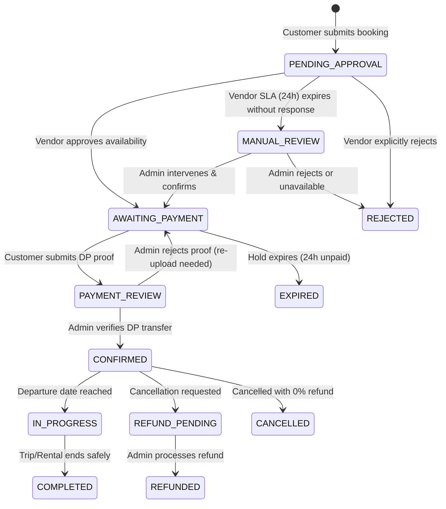

# Business Rules & Policy Engine — Lake Toba Travel Marketplace

- **Document Version:** 1.0
- **Status:** Final & Approved
- **Scope:** Canonical reference for all transactional, validation, and domain logic.

---

## 1. Product Catalog & Ownership Rules

### 1.1 Ownership Types & Platform-Curated Tour Model
The platform operates on a **Platform-Curated, Partner-Fulfilled Hybrid Model**:
- `INTERNAL` (Platform-Curated Tour Packages):
  - Created, designed, priced, and curated directly by the **Super Admin**.
  - `partner_id` in `products` is `NULL` upon creation.
  - Features standardized, high-converting itineraries across North Sumatra corridors (e.g., *6D5N Famtrip North Sumatra: Bukit Lawang - Medan - Danau Toba*, *1D Keliling Samosir Eksotis*, *Open Trip Danau Toba Rp 270k/orang*).
  - Automatically approved upon creation (`approval_status = APPROVED`, `status = PUBLISHED`).
  - **Fulfillment via Dispatching:** When a traveler books an `INTERNAL` package, the Super Admin (or dispatch engine) assigns/dispatches the booking to an approved, available **Partner** (transporter/rental/driver community) whose fleet matches the requirements.
- `PARTNER` (Partner-Owned Products):
  - Uploaded directly by an approved external local operator or rental provider (e.g., standalone car rental units like *Innova Reborn + Driver*, *HiAce 14-Seat*).
  - `partner_id` MUST reference an active, approved `partners` record.
  - Undergoes mandatory Admin review (`approval_status = APPROVED` and `status = PUBLISHED`) before appearing publicly.

### 1.2 Preset Inclusions Khas Sumatera Utara
To maintain consistent market standards and eliminate hidden fees for travelers, Tour Packages support standardized preset inclusions:
1. **BBM Pulang-Pergi (Fuel Included)** — Round-trip fuel covering highway and caldera routes.
2. **Driver merangkap Guide Lokal (Driver-Guide)** — Local driver experienced in steep caldera gradients and acting as friendly guide.
3. **Makan & Uang Rokok Supir (Driver Meals & Cigarettes Included)** — Eliminates uncomfortable tipping friction for travelers.
4. **Dokumentasi Foto & Video / Drone** — Professional visual documentation for social media.
5. **Tiket Ferry Danau Toba PP** — Bundled Ro-Ro or passenger ferry tickets (Ajibata - Tomok / Ambarita).
6. **Tiket Masuk Seluruh Objek Wisata** — Included entrance tickets to all itinerary stops.

### 1.3 Status Separation
A product maintains two independent status flags:
- `approval_status`: `DRAFT`, `PENDING_REVIEW`, `APPROVED`, `REJECTED`
- `status`: `DRAFT`, `PUBLISHED`, `ARCHIVED`, `SUSPENDED`
- **Rule:** A partner can only toggle `status = PUBLISHED` if `approval_status == APPROVED`.

### 1.4 Immutability of Historical Bookings
- Modifying a product's price, description, terms, or cancellation policy MUST NOT affect past or active bookings.
- When a booking is initialized, a comprehensive JSONB snapshot of the product and its policies is written to the booking record.

---

## 2. Booking Lifecycle & State Machine Rules

### 2.1 Independent State Dimensions
The platform strictly separates the lifecycle into three orthogonal dimensions:
1. **Booking Status:** Overall contractual agreement state.
2. **Payment Status:** Financial collection and balance state.
3. **Inventory Status:** Physical capacity and unit allocation state.



### 2.2 Booking Status Definitions
- `PENDING_APPROVAL`: Initial state upon checkout submission.
- `MANUAL_REVIEW`: Vendor did not respond within 24h; flagged for Admin manual intervention.
- `AWAITING_PAYMENT`: Vendor confirmed availability; 24h temporary hold active; awaiting DP payment.
- `PAYMENT_REVIEW`: Customer has uploaded payment proof; awaiting Admin verification.
- `CONFIRMED`: Minimum DP verified; inventory allocated; booking contractually locked.
- `IN_PROGRESS`: Service is actively taking place.
- `COMPLETED`: Service successfully fulfilled. Triggers partner settlement eligibility.
- `REJECTED`: Request rejected by vendor or admin due to unavailability.
- `EXPIRED`: Customer failed to submit payment proof within the 24-hour hold window.
- `CANCELLED`: Booking cancelled by customer or vendor (without pending financial refund).
- `REFUND_PENDING`: Cancellation approved; refund payout is awaiting admin processing.
- `REFUNDED`: Refund payout completed.

### 2.3 Payment Status Definitions
- `UNPAID`: Zero funds verified.
- `PAYMENT_REVIEW`: Payment proof uploaded by customer, awaiting verification.
- `PARTIALLY_PAID`: Minimum DP verified, remaining balance outstanding.
- `PAID`: 100% of the total booking price has been received and verified.
- `OVERDUE`: Remaining balance unpaid past the designated threshold (requires admin review).
- `REFUND_PENDING`: Awaiting refund disbursement.
- `REFUNDED`: Full or partial refund disbursed.

### 2.4 Inventory Status Definitions
- `NONE`: No capacity or unit is held.
- `HELD`: Temporary hold active (bounded by 24h timer).
- `ALLOCATED`: Contractually guaranteed inventory (post-DP confirmation).
- `RELEASED`: Previously held or allocated inventory returned to public availability.

---

## 3. SLA, Lead Time, and Availability Rules

### 3.1 Vendor Response SLA
- Every booking in `PENDING_APPROVAL` starts a **24-hour vendor response timer**.
- **Rule:** If the vendor does NOT respond within 24 hours, the system MUST transition the booking status to `MANUAL_REVIEW`.
- Automatic hard expiration is forbidden; Admin is notified to contact the vendor or reassign to an alternative unit.

### 3.2 Minimum Booking Lead Time
- **Tour Packages:** Pemesanan wajib dilakukan minimal **H-1 (24 jam)** sebelum waktu keberangkatan.
- **Vehicle Rentals:** Pemesanan wajib dilakukan minimal **H-12 jam** sebelum waktu sewa dimulai.
- Booking requests submitted within the restricted lead time are blocked by validation.

### 3.3 Temporary Inventory Hold (24-Hour Rule)
- Upon vendor approval, the booking enters `AWAITING_PAYMENT` and an `inventory_holds` record is created with `expires_at = NOW() + 24 HOURS`.
- During this 24-hour window, the requested seats (for tours) or the requested vehicle unit are held from other customers.
- If the customer fails to upload valid payment proof within 24 hours:
  - Inventory status transitions to `RELEASED`.
  - Booking status transitions to `EXPIRED`.
  - Notification sent to customer via WhatsApp.

---

## 4. Payment & Down Payment (DP) Rules

### 4.1 Down Payment Configuration
- The system supports a configurable DP percentage.
- **Default System DP:** **30%** of the total product price.
- Admin has the authority to adjust DP percentages per product or catalog category.
- Customer may choose to pay either:
  1. Minimum Down Payment (e.g., 30%).
  2. Full Payment (100%).

### 4.2 Balance Settlement (Pelunasan)
- Outstanding balance may be paid incrementally or in full at any time up until the departure date/time.
- A booking remains `CONFIRMED` even if payment status is `PARTIALLY_PAID`.
- Late balance payments on departure day do not trigger automated cancellation; they are flagged for operational and driver/tour-leader confirmation.

### 4.3 Manual Bank Transfer Verification Flow
1. Booking reaches `AWAITING_PAYMENT`.
2. System displays platform bank accounts (BCA, Mandiri, BRI) and exact payment amount with an automated WhatsApp notification dispatched to the customer.
3. Customer transfers funds and uploads proof image (JPG, PNG, PDF up to 5MB) on the web portal.
4. Booking status updates to `PAYMENT_REVIEW`.
5. Admin verifies the transaction in the bank ledger:
   - If valid: Admin marks payment as `VERIFIED`. Booking moves to `CONFIRMED` (or `PARTIALLY_PAID` / `PAID`).
   - If invalid/fraudulent: Admin rejects proof with a mandatory reason. Booking returns to `AWAITING_PAYMENT` with an alert to customer.

---

## 5. Cancellation & Refund Rules

### 5.1 Refund Eligibility Schedule (MVP Baseline)
Refund percentage is determined by the timestamp of cancellation relative to the scheduled departure time:

| Cancellation Timing | Refund Percentage | Inventory Action |
| :--- | :--- | :--- |
| **> 7 Days ( > 168 hours )** before departure | **100%** | Immediately `RELEASED` |
| **3 – 7 Days ( 72 – 168 hours )** before departure | **50%** | Immediately `RELEASED` |
| **< 3 Days ( < 72 hours )** before departure | **0% (Non-refundable)** | Immediately `RELEASED` |

### 5.2 Basis of Refund Calculation
- **CRITICAL RULE:** The refund percentage is strictly applied to the **amount actually paid** by the customer (cumulative verified receipts), NOT to the full booking price.
- *Example:*
  - Total Booking Price: Rp2,000,000.
  - Customer paid 30% DP: Rp600,000.
  - Customer cancels 4 days prior (50% bracket).
  - Refund Amount = 50% × Rp600,000 = **Rp300,000**. (Remaining Rp300,000 retained by platform/vendor).

### 5.3 Vendor Cancellation
- If a vendor cancels a confirmed booking due to force majeure, mechanical breakdown, or extreme Lake Toba weather:
  - Customer is entitled to **100% Full Refund** of all paid amounts, OR
  - Mutual agreement to **Reschedule** at no penalty.

---

## 6. Commission & Partner Settlement Rules

### 6.1 Platform Commission Model (Configurable & Optional by Agreement)
- Platform commission is calculated as a percentage of the base product price.
- **Default Baseline Commission:** **10%** (resulting in a 90% partner net payout).
- **Rule on Flexibility:** The commission percentage is **configurable and optional** based on bilateral partnership terms, contractual agreements, product type, or promotional campaign arrangements.
- **Immutability Rule:** The agreed commission percentage (`commission_percentage`) is snapshotted into the `bookings` record at creation and remains immune to future commission changes.
- Commission is only earned on completed, non-refunded transactions.

### 6.2 Settlement Eligibility & Lifecycle
- Settlement records (`vendor_settlements`) transition through:
  - `PENDING` $\rightarrow$ Created once booking is `CONFIRMED`.
  - `ELIGIBLE` $\rightarrow$ Triggered automatically when booking reaches `COMPLETED`.
  - `PROCESSING` $\rightarrow$ Admin batches payout to vendor's verified bank account.
  - `PAID` $\rightarrow$ Bank reference number attached; funds transferred.
  - `ON_HOLD` $\rightarrow$ If there is an active customer complaint, dispute, or pending refund.

---

## 7. Dispatching & Partner Booking Assignment Rules

### 7.1 Platform-Curated Package Dispatching
- When a traveler books an `INTERNAL` (Platform-Curated) package:
  1. The booking is created with `partner_id = NULL` or flagged for Admin assignment.
  2. The Super Admin accesses the **Booking Dispatch Interface** in Admin Console.
  3. The system presents available, approved Partners filtered by:
     - Operational geographic cluster (e.g., Medan, Parapat, Samosir).
     - Fleet vehicle type capacity matching the passenger count (e.g., Avanza for 1-5 pax, Innova for 6-7 pax, HiAce for 8-14 pax).
     - Partner performance metrics (highest `average_rating` and highest `completed_trips_count`).
  4. Admin selects and dispatches the booking to the designated Partner.
  5. The Partner receives an immediate WhatsApp and in-portal alert with a 24-hour response SLA to assign a specific vehicle unit and driver.

### 7.2 Partner Assignment SLA & Fallback
- If the dispatched Partner does not confirm or rejects within 24 hours:
  - The booking enters `MANUAL_REVIEW`.
  - Admin receives an urgent prompt to re-dispatch the order to an alternate qualified Partner.
  - The traveler's schedule remains protected and unaffected.

---

## 8. Partner Performance, Trip History & Review System

### 8.1 Completed Trips History Counter
- The system automatically aggregates the lifetime completed trip count for every Partner:
  $$\text{completed\_trips\_count} = \text{Count of bookings where } \text{partner\_id} = \text{Partner ID} \land \text{booking\_status} = \text{COMPLETED}$$
- This metric represents the Partner's real-world operational track record and cannot be manually fabricated.
- Displayed prominently in:
  1. **Admin Console Dispatch Selector:** Enables Admin to pick verified, highly experienced operators.
  2. **Partner Portal Dashboard:** Visual reputation badge for the partner.
  3. **Public Product/Checkout Badges:** Shows travelers e.g., *"Dijalankan oleh Mitra Berizin ★ 4.9 (34 Trip Selesai)"*.

### 8.2 Customer Reviews & Star Ratings
- **Eligibility:** A Customer is ONLY eligible to submit a review once the booking status transitions to `COMPLETED`.
- **Review Dimensions:**
  - `rating`: Overall trip rating (1 to 5 Stars, mandatory).
  - `driver_rating`: Sub-score for driver punctuality, hospitality, and mountain route safety (1 to 5 Stars, optional).
  - `vehicle_rating`: Sub-score for vehicle air conditioning, clean interior, and suspension comfort (1 to 5 Stars, optional).
  - `comment`: Free-text review describing customer experience (optional).
- **One Review per Booking:** Enforced via a database unique constraint on `booking_id`.
- **Aggregation:**
  $$\text{average\_rating} = \frac{\sum \text{rating}}{\text{total\_reviews\_count}}$$
  Recalculated upon every approved review submission.

---

## 9. Two-Tier Authorization & Role Permission Matrix

The platform strictly separates user capabilities into two distinct RBAC tiers:

```
[Level 1: System-wide User Role (users.role)]
  ├── SUPER_ADMIN : Platform Owner / Central Operations
  ├── PARTNER     : Local Transporter / Rental Operator / Driver Organization
  └── CUSTOMER    : Registered Traveler / Tourist

[Level 2: Partner Organization Role (partner_members.role)]
  ├── OWNER : Legal business owner / Proprietor with financial authority
  └── STAFF : Operational driver / Dispatch coordinator without financial access
```

### 9.1 Role Definition & Capability Matrix

| Capability / Action | SUPER_ADMIN | PARTNER (OWNER) | PARTNER (STAFF) | CUSTOMER |
| :--- | :---: | :---: | :---: | :---: |
| **Manage Master Destinations & Spots** | **Full** | View Public | View Public | View Public |
| **Create & Publish Platform Curated Packages** | **Full** | — | — | — |
| **Register & Manage Vehicle Fleet** | Audit / View | **Full CRUD** | View Fleet | — |
| **Assign Driver & Unit to Dispatched Trip** | Dispatch Partner | **Assign** | **Assign** | — |
| **View Customer Manifest & Pickup Schedule** | **Full** | **Full** | **Operational Only** | Own Booking |
| **Approve / Verify Availability (SLA 24h)** | Force Intervene | **Yes** | **Yes** | — |
| **Verify Bank Transfer Proof (DP)** | **Full** | — | — | — |
| **View Settlement Ledger & Financial Balances**| **Full Platform** | **Own Payouts** | **FORBIDDEN (403)** | — |
| **Update Bank Account Details for Payout** | Audit | **Own Bank Info**| **FORBIDDEN (403)** | — |
| **Invite / Manage Partner Staff Accounts** | Audit | **Full CRUD** | **FORBIDDEN (403)** | — |
| **Submit Booking & Pay DP** | — | — | — | **Full** |
| **Submit Post-Trip Rating & Review** | Moderate | View Received | View Received | **Submit Own** |
| **Audit Logs & System Health** | **Full** | — | — | — |

### 9.2 Partner Member Isolation Rules
- **Rule 1 (Multi-Tenancy):** A `PARTNER` user belonging to Partner A can NEVER view, query, or mutate vehicles, bookings, staff, or settlements belonging to Partner B. Enforced via Eloquent global scopes and Laravel Policies (`PartnerPolicy`).
- **Rule 2 (Staff Financial Redaction):** `PartnerMember` with `role = STAFF` is strictly forbidden from accessing `/partner/settlements`, viewing bank numbers, or altering payout configurations. Enforced via `EnsureUserIsPartnerOwner` middleware and policy checks.
- **Rule 3 (Customer Privacy):** Customers can only view their own booking records, payment receipts, and review submissions. Customer PII (phone number, email) is only exposed to assigned Partner drivers for the duration of active trip pickup coordination.

---

## 10. Anti-Disintermediation & Win-Win Protection Engine

### 10.1 Strategic Philosophy: Ekosistem Saling Menguntungkan ("Win-Win")
Praktek transaksi di luar platform (*disintermediation* atau *kebocoran jalur belakang*) sering terjadi ketika traveler dan supir bertukar nomor kontak lalu sepakat bertransaksi offline untuk menghindari biaya platform.

Platform Muter-Muter mengadopsi filosofi: **Pencegahan kebocoran BUKAN dengan restriksi yang kaku atau saling memusuhi, melainkan dengan memberikan keunggulan nilai tambah (Value Locks) yang membuat kedua belah pihak (Wisatawan & Mitra Supir) merasa jauh lebih aman, untung, dan terlindungi jika bertransaksi di dalam platform.**

```
                         [ MUTER-MUTER PLATFORM ]
                                    │
           ┌────────────────────────┴────────────────────────┐
           ▼                                                 ▼
[ PILAR 1: MITRA SUPIR UNTUNG ]             [ PILAR 2: WISATAWAN TENANG & PUAS ]
• Akumulasi Trip & Star Rating Resmi       • Garansi Unit Pengganti (1-2 Jam Rusak di Rute)
• Priority Dispatch Order Bernilai Tinggi   • Include Tiket Ferry & Uang Makan/Rokok Supir
• Kompensasi DP Pembatalan (< 3 Hari)       • Invoice Resmi & Reward Poin Trip Berikutnya
• Bebas Perang Tarif Liar                  • Bebas Pungli & Canggung di Jalan
           │                                                 │
           └────────────────────────┬────────────────────────┘
                                    ▼
       [ PILAR 3: MASKED & TIMED CONTACT RELEASE (H-1 BUKA KONTAK) ]
       [ PILAR 4: KOMISI WAJAR 10% (MITRA 90%) & KODE ETIK MITRA   ]
```

### 10.2 Pilar 1: Driver Loyalty & Priority Dispatching Engine (Mitra Diuntungkan)
1. **Reputasi Permanen & Terverifikasi:**
   - Jumlah `completed_trips_count` dan rating bintang (`average_rating`, misal ★ 4.9) hanya dapat bertambah jika transaksi diproses melalui platform.
   - Reputasi ini menjadi portofolio digital resmi mitra untuk menarik ribuan wisatawan dari luar Sumatera Utara. Transaksi offline tidak menghasilkan rekam jejak.
2. **Hak Istimewa Priority Dispatch:**
   - Super Admin memprioritaskan order paket bernilai tinggi (misal Famtrip 6D5N, rombongan HiAce turis mancanegara, sewa jangka panjang) kepada mitra dengan badge reputasi tertinggi.
   - Mitra yang mencoba bertransaksi offline kehilangan prioritas dispatch dan dialihkan ke antrian terbawah.
3. **Kompensasi Pembatalan Terjamin (Protection Lock):**
   - Jika wisatawan membatalkan trip secara mendadak (< 3 hari sebelum keberangkatan) atau no-show, mitra tetap menerima kompensasi Down Payment (DP) atas hari kerja yang sudah dialokasikan.
   - Pada transaksi offline (jalur belakang), supir sering dirugikan tanpa jaminan ganti rugi ketika tamu membatalkan sepihak.
4. **Kepastian Pendapatan & Bebas Perang Tarif:**
   - Standar biaya harian dan komponen pengeluaran (BBM, uang makan & rokok supir) sudah terstruktur dan dijamin dibayarkan penuh melalui settlement resmi platform tanpa tawar-menawar liar di lapangan.

### 10.3 Pilar 2: Traveler Protection Locks & Value Guarantee (Wisatawan Diuntungkan)
1. **Garansi Armada Pengganti Darurat (Emergency Vehicle Replacement SLA):**
   - Rute Sumatera Utara melintasi medan terjal, berliku, dan pegunungan (misal: tanjakan Tele Danau Toba, tebing Sibea-bea, hutan Bukit Lawang, perbukitan Merek/Tongging).
   - **Komitmen Platform:** Jika kendaraan mengalami mogok mesin, pecah ban ganda, atau kendala mekanikal di tengah perjalanan, platform menjamin **pengiriman unit pengganti beserta supir cadangan dari jaringan mitra terdekat dalam waktu 1–2 jam**.
   - Supir perorangan (jalur belakang) tidak memiliki jaringan armada cadangan dan tidak mampu memberikan garansi penyelamatan ini jika terjadi kerusakan fatal.
2. **Bundled Value-Adds Bebas Canggung:**
   - Paket wisata resmi mencakup fasilitas lengkap: tiket kapal ferry Danau Toba terjadwal, BBM PP, serta biaya makan dan uang rokok supir. Wisatawan terbebas dari rasa canggung, permintaan tips terselubung, atau pungutan liar.
3. **Dokumen Legal & Invoice Resmi:**
   - Wisatawan instansi, korporasi, keluarga besar, atau rombongan komunitas mendapatkan invoice dan kwitansi resmi berbadan hukum untuk keperluan klaim reimbursement kantor, yang tidak bisa disediakan oleh supir lepas offline.
4. **Loyalitas & Cashback Trip Berikutnya:**
   - Setiap transaksi yang berhasil memberikan poin reward/voucher diskon untuk pemesanan rute wisata Sumatera Utara berikutnya (misal sewa mobil di Medan atau trip trekking ke Tangkahan).

### 10.4 Pilar 3: Masked & Timed Contact Release (Proteksi Intermediasi)
Untuk menjaga keamanan data pribadi dan mencegah bypass kontak sebelum komitmen pesanan terkonfirmasi:
1. **Masking Kontak Pra-Keberangkatan:**
   - Nomor WhatsApp dan nomor telepon customer serta mitra/supir disamarkan (*masked*) pada halaman katalog, form checkout, dan dashboard awal.
   - Komunikasi pra-keberangkatan difasilitasi melalui notifikasi otomatis sistem WhatsApp Gateway Muter-Muter.
2. **Pelepasan Kontak Otomatis pada H-1 (Timed Release):**
   - Kontak langsung antara Driver dan Wisatawan **hanya dibuka tepat H-1 (24 jam sebelum jadwal keberangkatan/penjemputan)** melalui E-Voucher digital dan pesan WhatsApp terintegrasi.
   - Tujuan pelepasan kontak pada H-1 murni untuk sinkronisasi teknis kedatangan: konfirmasi nomor penerbangan di Bandara Kualanamu (KNO) / Silangit (DTB), nomor gerbang kedatangan (Gate Arrival), dan koordinasi titik kumpul penjemputan.

### 10.5 Pilar 4: Komisi Wajar (10% Take-Rate) & Pakta Integritas Mitra
1. **Struktur Bagi Hasil Sehat (90% Mitra, 10% Platform):**
   - Berbeda dengan OTA konvensional yang memotong komisi 20%–30%, platform Muter-Muter menetapkan baseline komisi bersahabat sebesar **10%** (mitra menerima bersih 90% dari nilai sewa/transportasi).
   - Skema komisi bersifat fleksibel/konfigurabel untuk promosi atau perjanjian kerjasama khusus.
2. **Pakta Integritas (Partner Code of Conduct):**
   - Setiap mitra yang mendaftar wajib menyetujui ketentuan etika kemitraan: dilarang keras membujuk, menawarkan, atau mengarahkan wisatawan untuk membatalkan pesanan platform demi transaksi offline.
   - Pelanggaran terhadap ketentuan ini berakibat:
     - Penangguhan (*suspension*) akun mitra dan armada.
     - Penahanan (*on-hold*) dana settlement yang sedang berjalan.
     - Penghapusan badge reputasi dan pencabutan hak prioritas dispatch.

---

## 11. Katalog Paket Acuan & Standar Biaya Sumatera Utara

Berdasarkan analisa operasional lapangan di Sumatera Utara, berikut adalah acuan paket resmi platform yang dikelola terpusat oleh Super Admin dan difasilitasi oleh armada mitra:

### 11.1 Paket Acuan 1: 6D5N Famtrip North Sumatra (Lintas Koridor Unggulan)
Rute komprehensif mencakup Bandara KNO, Bukit Lawang, Medan Heritage, Parapat, dan Pulau Samosir:

| Hari | Rute & Agenda Utama | Highlight Destinasi | Standar Biaya Armada (Termasuk BBM, Driver, Makan & Rokok Supir) |
| :--- | :--- | :--- | :--- |
| **Hari 1** | Arrival Bandara KNO $\rightarrow$ Bukit Lawang | Welcome dance Disbudparekraf, Orangutan Sanctuary, Check-in Eco Lodge Resort | **Rp 1.200.000 / hari** |
| **Hari 2** | Bukit Lawang $\rightarrow$ Medan City | Jungle Trekking Taman Nasional Gunung Leuser, River Tubing, Kuliner RM Garuda, Hotel Grand Mercure | **Rp 1.200.000 / hari** |
| **Hari 3** | Medan Heritage City Tour | Maha Vihara Maitreya, Museum Negeri Sumut, Pos Bloc, Seng Hap 1881 Kesawan, Tjong A Fie Mansion | **Rp 1.000.000 / hari** |
| **Hari 4** | Medan $\rightarrow$ Parapat $\rightarrow$ Samosir | Scenic boat cruising Danau Toba, Batu Gantung, Air Terjun Situmurun, Ecovillage Silimalombu, Huta Siallagan | **Rp 1.300.000 / hari** |
| **Hari 5** | Keliling Pulau Samosir | Bukit Holbung, Air Terjun Efrata, Bukit Cinta, Patung Yesus Sibea-bea, Pemandian Air Panas Pangururan, Samosir Waterfront | **Rp 1.300.000 / hari** |
| **Hari 6** | Samosir $\rightarrow$ Medan via Jalan Tol | Jembatan Tano Ponggol, Jalan Tol Tebing Tinggi - Medan, Drop-off Bandara KNO / Stasiun Medan | **Rp 1.300.000 / hari** |

### 11.2 Paket Acuan 2: 1-Day Tour Eksotis Danau Toba & Samosir
Pilihan paket harian terpopuler untuk wisatawan domestik dan lokal:
- **Opsi Open Trip (Per Orang):** Mulai **Rp 250.000 – Rp 270.000 / orang** (Armada Avanza/HiAce bersama, minimal kuota keberangkatan terpenuhi).
- **Opsi Private Trip (Per Kendaraan):** Mulai **Rp 1.500.000 / unit kendaraan** (Avanza / Innova Reborn + Supir + BBM).
- **Rute Destinasi Unggulan:**
  1. Air Terjun Efrata
  2. Bukit Holbung (Bukit Teletubbies Danau Toba)
  3. Bukit Cinta
  4. Patung Yesus Sibea-bea & Bukit Panorama
  5. Jembatan Ikonik Tano Ponggol
  6. Waterfront City Pangururan
  7. Pemandian Air Panas Alami Pangururan
  8. Danau di Atas Danau (Bukit & Danau Sidihoni)
- **Fasilitas Termasuk (Preset Inclusions):**
  - Armada Mobil SUV/MPV ber-AC dingin
  - BBM Pulang-Pergi
  - Driver profesional merangkap Guide Lokal
  - Uang makan & rokok supir
  - Air mineral & snack perjalanan
  - Dokumentasi foto & video / drone
  - Tiket Ferry penyeberangan Danau Toba PP

---

## 12. Relasi Sistem & Binding Foto: Destinasi ke Paket Wisata

### 12.1 Arsitektur Relasi Database
Untuk memastikan data tidak redundan dan wisatawan mendapatkan gambaran visual yang nyata mengenai setiap titik persinggahan tour:
1. **Foreign Key Binding:**
   - Tabel `tour_itinerary_stops` memiliki kolom `destination_id` bertipe `UUID NULLABLE` dengan foreign key berelasi ke `destinations.id`.
   - Sebuah perhentian (*stop*) dapat mereferensikan satu destinasi master terdaftar.
2. **Auto-Aggregated Photo Gallery (Galeri Foto Otomatis):**
   - Setiap destinasi menyimpan galeri medianya di tabel `destination_media`.
   - Halaman detail paket wisata (`Tours/Show.vue`) secara otomatis mengekstraksi media dari seluruh destinasi yang dikunjungi dalam paket tersebut:
     $$\text{TourMediaCollection} = \text{ProductMedia} \cup \bigcup_{s \in \text{Stops}} \text{DestinationMedia}(s.\text{destination\_id})$$
   - Admin tidak perlu mengunggah ulang foto-foto objek wisata yang sama (seperti Bukit Holbung, Air Terjun Efrata, Patung Sibea-bea) saat membuat paket baru.
3. **Visual Timeline & Interactive Stops:**
   - Pada timeline itinerary (Hari 1, Hari 2, dst.), setiap *stop* yang terhubung dengan `destination_id` akan menampilkan:
     - Thumbnail foto resmi destinasi.
     - Nama destinasi dan badge klaster (misal: "Samosir Barat").
     - Estimasi durasi kunjungan (misal: "90 menit").
     - Tautan langsung (*link*) yang dapat diklik ke halaman destinasi lengkap (`/destinations/{slug}`).

---

## 13. Standar Kebersihan, Kelayakan & Kenyamanan Armada (Clean Vehicle Standard)

### 13.1 Standar Wajib Kendaraan Mitra
Sebagai bagian dari jaminan perlindungan wisatawan dan reputasi platform, seluruh kendaraan mitra (Avanza, Innova, HiAce, Alphard) wajib memenuhi Standar Emas Armada:
1. **Kebersihan Kabin & Sanitasi:**
   - Kabin wajib dibersihkan dan disedot debu (*vacuum*) sebelum setiap penjemputan tamu.
   - Kabin wajib beraroma segar dan **bebas total dari asap rokok** atau abu rokok dari perjalanan sebelumnya.
   - Jok dan sabuk pengaman (*seatbelt*) berfungsi normal dan bersih tanpa noda.
2. **Kenyamanan Suhu (AC Dingin):**
   - Sistem pendingin udara (AC) wajib dingin dan berfungsi optimal di seluruh baris kursi hingga baris belakang (terutama pada rute panas seperti jalur Medan - Tebing Tinggi).
3. **Kelaikan Teknis Rute Pegunungan:**
   - Mengingat kondisi topografi Danau Toba dan Karo yang curam dan berliku, armada wajib memiliki:
     - Sistem pengereman (kampas rem dan minyak rem) dalam kondisi prima.
     - Ban dengan alur tapak layak (tidak botak / gundul) dan membawa ban cadangan siap pakai beserta dongkrak.
     - Sistem pendingin mesin (radiator & cairan coolant) normal untuk mencegah overheat di tanjakan Tele / Bukit Lawang.
4. **Verifikasi & Evaluasi Pengguna:**
   - Review wisatawan pasca-trip mencakup penilaian spesifik `vehicle_rating` (1–5 bintang) yang menilai kebersihan, AC, dan suspensi.
   - Mitra dengan rating kendaraan di bawah 4.0 akan mendapatkan notifikasi peringatan dan penangguhan sementara sampai unit diinspeksi ulang.


