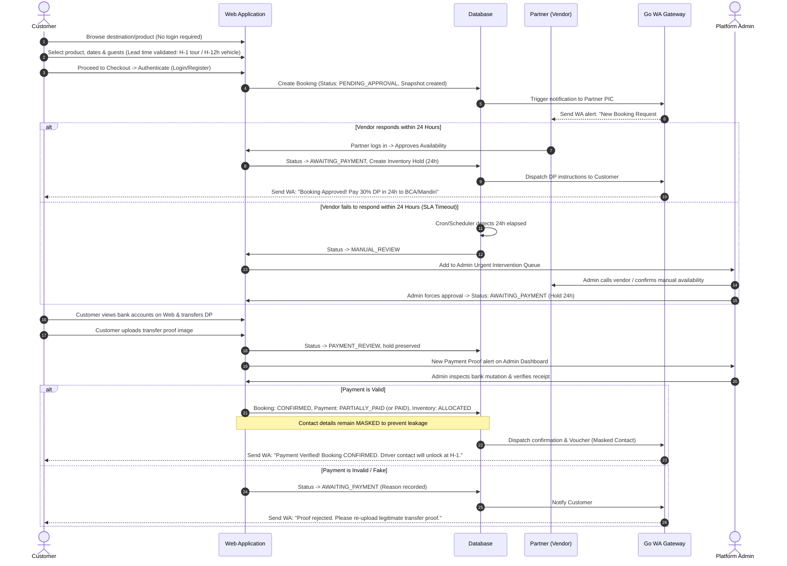
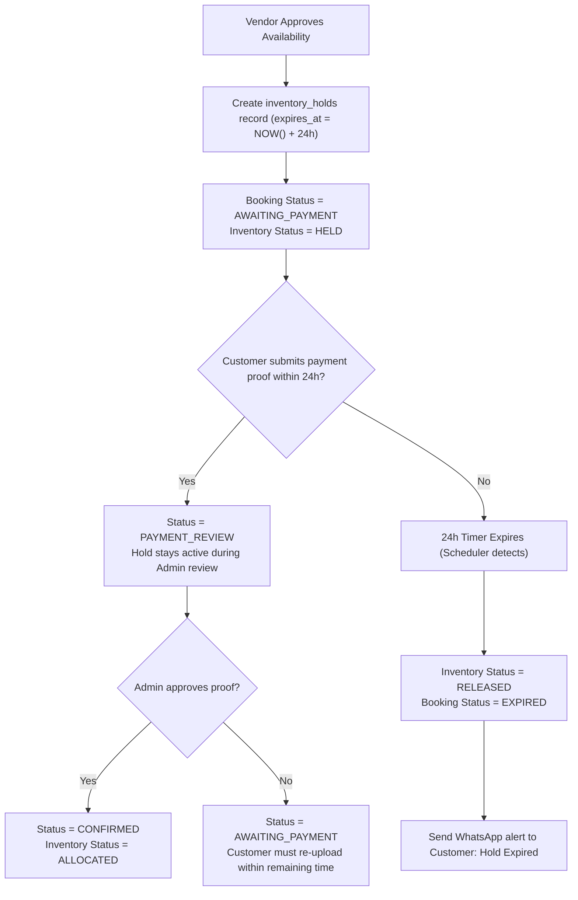
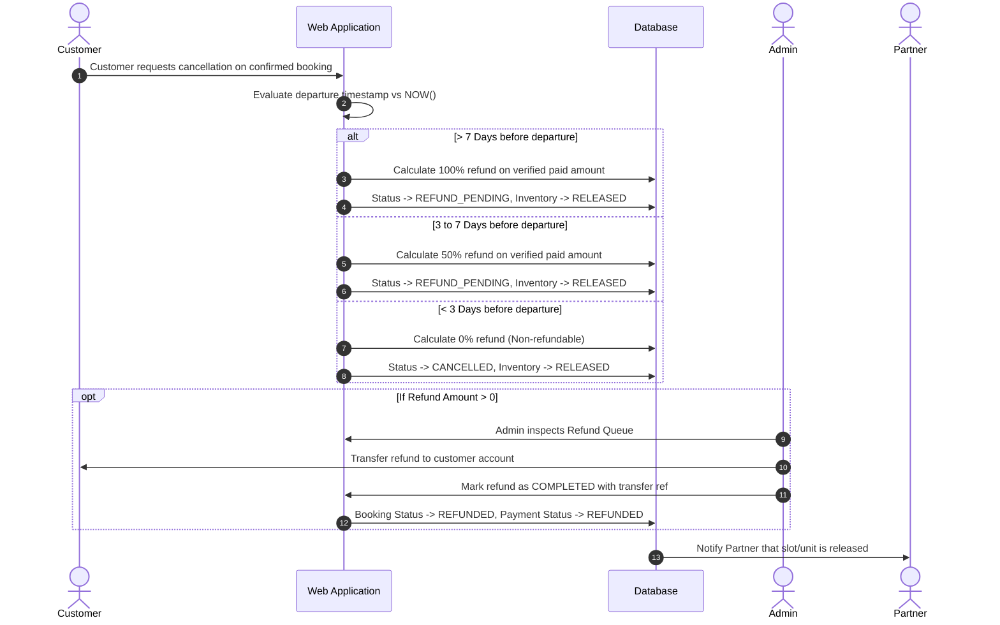
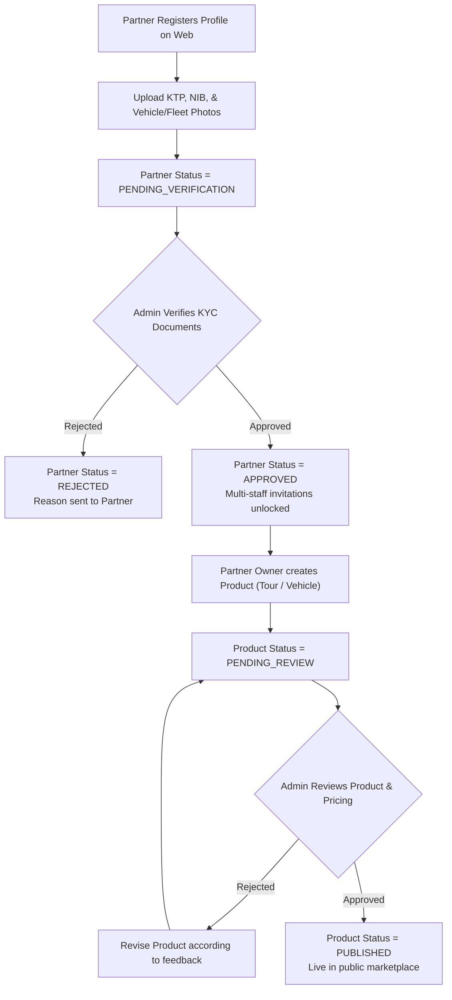
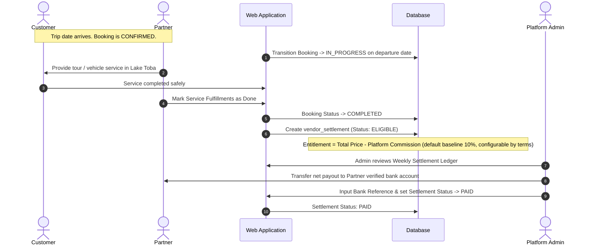
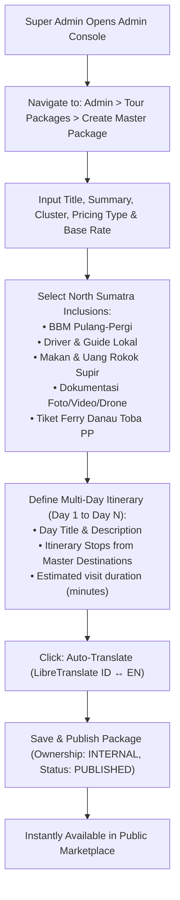
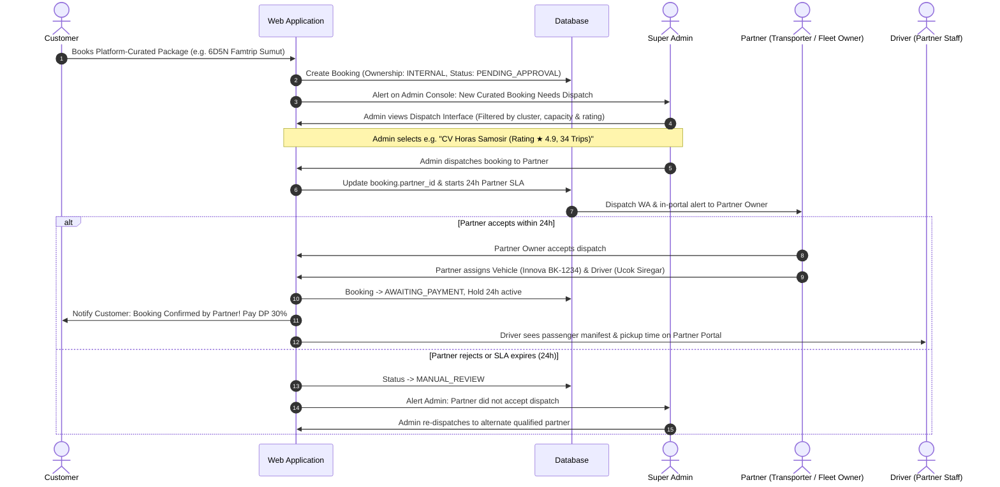
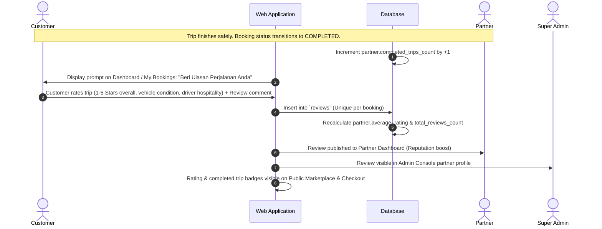
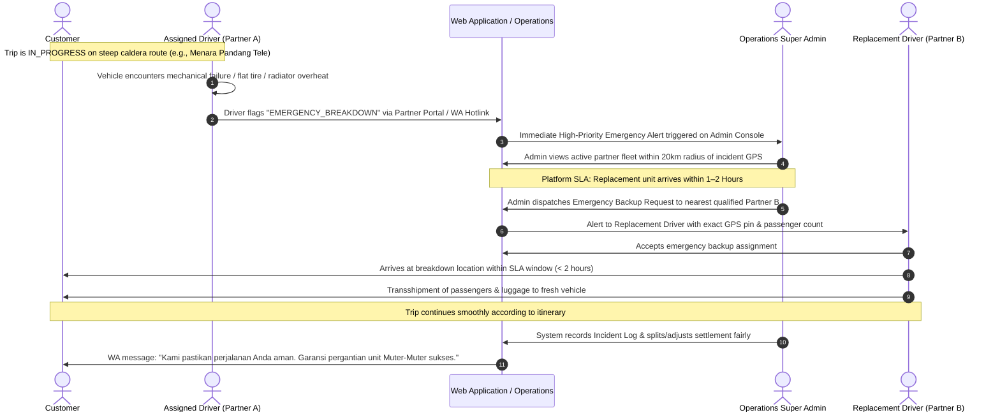
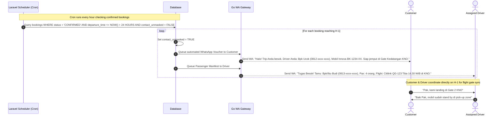

# End-to-End User Flows — Lake Toba Travel Marketplace

- **Document Version:** 1.0
- **Status:** Approved Post-Grooming

---

## 1. Discovery, Booking & Semi-Automated Payment Flow (Opsi A)

This flow illustrates the end-to-end journey from initial customer search to verified booking confirmation.

---

## 2. 24-Hour Temporary Inventory Hold & Expiration Flow

---

## 3. Customer Cancellation & Refund Processing Flow

---

## 4. Partner Onboarding & Product Lifecycle Flow

---

## 5. Trip Fulfillment & Partner Settlement Flow

---

## 6. Admin Platform-Curated Tour Package Creation Flow

---

## 7. Booking Dispatching & Partner Assignment Flow

---

## 8. Customer Review, Rating & Partner Trip Counter Flow

---

## 9. Emergency Vehicle Replacement & Breakdown Guarantee Flow

This flow illustrates the platform's value guarantee in the event of mechanical breakdown in remote mountain/caldera terrain (e.g. Tele, Sibea-bea, Tongging, Bukit Lawang). Solo offline drivers cannot provide this network guarantee.

---

## 10. Timed Contact Release & Airport Pickup Sync Flow (H-1 Departure)

To eliminate off-platform leakage while guaranteeing seamless coordination upon arrival at Kualanamu (KNO) or Silangit (DTB) Airport, direct contacts are released precisely 24 hours prior to scheduled departure.

