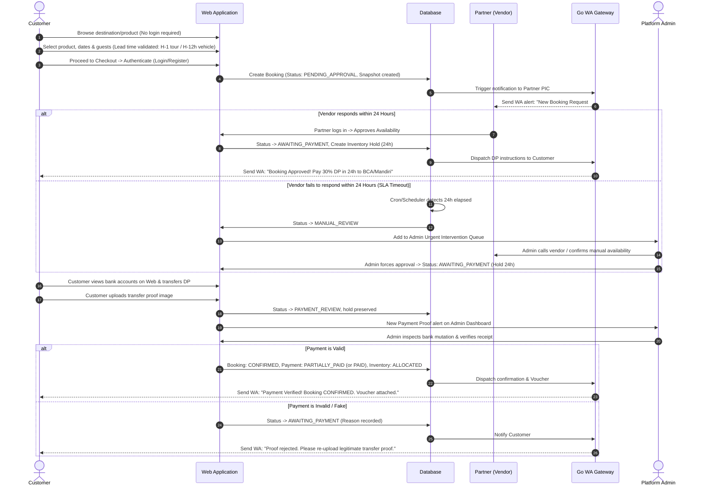
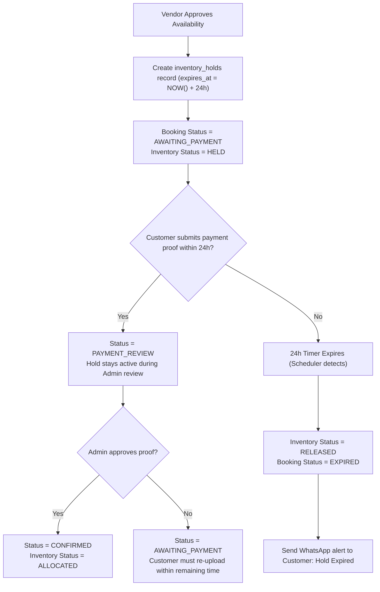
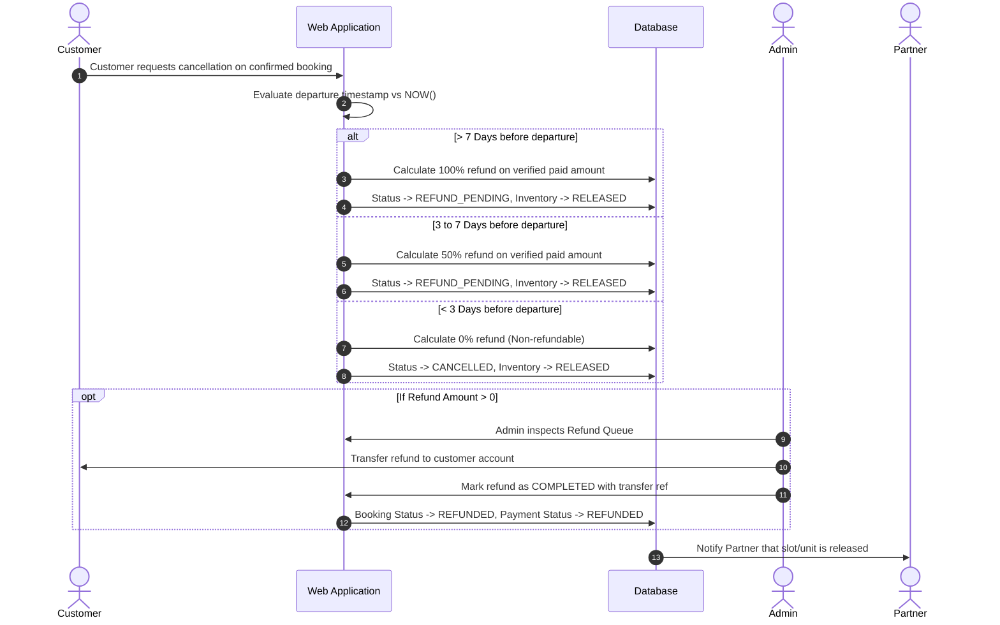
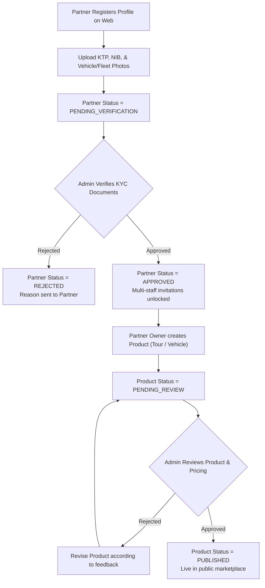
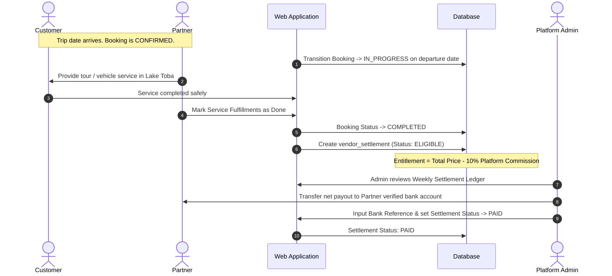

# End-to-End User Flows — Lake Toba Travel Marketplace

- **Document Version:** 1.0
- **Status:** Approved Post-Grooming

---

## 1. Discovery, Booking & Semi-Automated Payment Flow (Opsi A)

This flow illustrates the end-to-end journey from initial customer search to verified booking confirmation.

---

## 2. 24-Hour Temporary Inventory Hold & Expiration Flow

---

## 3. Customer Cancellation & Refund Processing Flow

---

## 4. Partner Onboarding & Product Lifecycle Flow

---

## 5. Trip Fulfillment & Partner Settlement Flow

